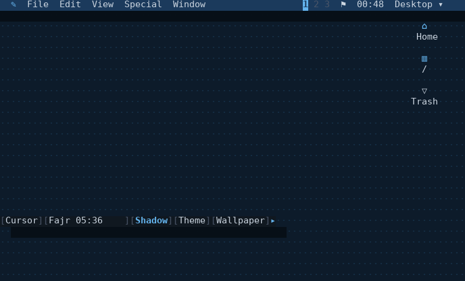
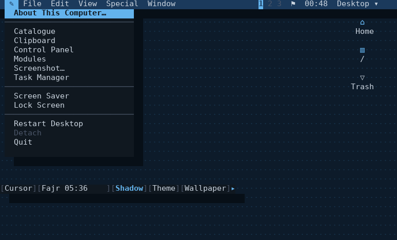
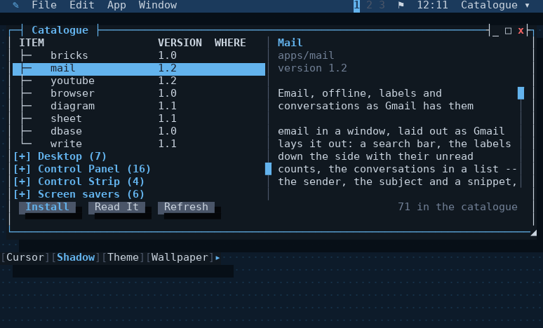
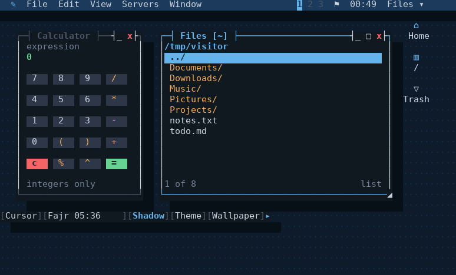
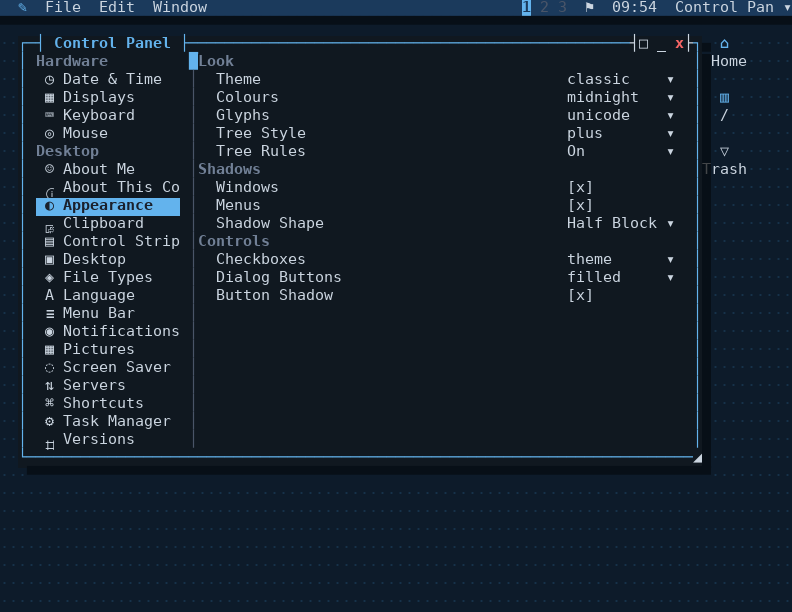

# Your first hour with the desktop

hibr comes with a desktop that runs in a terminal: windows you drag with
the mouse, a menu bar, a wallpaper, a Control Panel, screen savers, and
applications that are each a hibr script you can read. This page walks
through the first hour, in order, on the desktop exactly as the package
installs it. Every picture is a real render of a real session
(`tools/docshots.py` remakes them all), nothing drawn by hand.

If hibr is not installed yet, the [project README](../README.md#install)
has a line for apt, Homebrew and a source build.

## 1. Start it

<!-- not run: takes over the terminal it is started in -->
```sh
desktop
```



That is the whole of it: a menu bar, the wallpaper, three icons (your home
folder, the root of the disk, and the trash), and the Control Strip near
the bottom. The mouse works in any terminal that reports it -- click,
drag, right-click, the wheel. The keyboard works everywhere: **F10** or
**escape** opens the menu bar, and the arrows and the underlined letters
move through it. With the hibr menu open, **`/`** searches everything on
it -- each application, in whatever folder, and the desktop's own apps
and actions -- and enter opens what is highlighted.

The desktop is **held**, which is the first thing worth knowing: it does
not belong to the terminal you started it in. Press **ctrl-\\** and you are
back at your shell with the desktop still running; close the terminal,
log out, come back from another machine, and

<!-- not run: needs a held desktop to come back to -->
```sh
desktop -r
```

puts you back where you were, windows, running programs and all. A second
terminal can join the same desktop as another display with `desktop -j`.

## 2. Look in the hibr menu

The menu at the far left, under the ✎, is the desktop's own.



What is listed there manages or reports on the desktop: About This
Computer, the Control Panel, the Task Manager, the clipboard's history, a
screenshot tool, the modules that are loaded. Restart Desktop starts the
window manager again without closing your windows; Quit ends it.

**Applications** opens the programs that come with the desktop: Files and
Terminal, and under Accessories a calculator, a clock, an image viewer,
sticky notes and a sliding puzzle. Everything else -- mail, calendars, a
browser, a spreadsheet, games -- comes from one place, which is the next
step.

## 3. Open the Catalogue

Choose **Catalogue** from the hibr menu.



The Catalogue lists what there is to install -- applications, Control
Panel panes, strip modules, screen savers, themes, colour schemes,
languages -- each with a description and the version it is at. Pick one
and press **Install**. Each of them is a hibr script or a JSON file, so
nothing is compiled and nothing needs root: it is put in a folder of
yours that the desktop already reads.

The same catalogue is a command, for a shell with no desktop in it:

<!-- not run: fetches the index over HTTPS -->
```sh
catalogue list mail
catalogue install mail snake
```

```text
apps           contacts      Contacts                  1.2
apps           calendar      Calendar                  1.1
apps           mail          Mail                      1.2
installed control-panel/mailset.hibr, which mail brings with it
installed mail as ~/.local/share/hibr/apps/Internet/mail.hibr
installed snake as ~/.local/share/hibr/apps/Games/snake.hibr
```

Mail brought its Control Panel pane with it, and said so: an
application's pane comes with the application and goes when it goes. The
index is
signed, and it holds every bundle's sha256, so what arrives is what the
catalogue published; `catalogue show NAME` prints a script without
placing it, if you would rather read it first. [The
catalogue](catalogue.md) has the rest -- what it trusts, what it refuses,
and how to run a catalogue of your own.

## 4. Open some windows

What the Catalogue installs is on the menus the moment it is installed,
under Applications beside what came with the desktop, and the same goes
for something installed with `catalogue install` from a terminal, which
tells every desktop you are running.



Drag a window by its title bar, and resize it from its bottom-right
corner. The buttons at the top right of each window minimise, maximise
and close it. A few keys are worth learning early:

| | |
|---|---|
| **alt-tab**, **alt-shift-tab** | the window switcher: the window list, stepped forward or back; a pause goes there, escape goes nowhere |
| **alt-left**, **alt-right** | snap the window to that half of the screen |
| **alt-up**, **alt-down** | zoom the window, minimise it |
| **alt-1**, **alt-2**, **alt-3** | change workspace -- the three numbers in the bar |
| **alt-w** | close the window |
| **alt-c**, **alt-x**, **alt-v** | copy, cut and paste, between any two windows |
| **ctrl-\\** | detach, as above |

Every one of them can be changed in Control Panel > Shortcuts, and a
terminal window passes ctrl keys through to its program, so ctrl-c still
interrupts what is running in it. The alt in all of them is one setting,
**Shortcut Key** at the top of that pane: Alt, Super or Alt, or Super. On
Super or Alt, super-w closes a window as well as alt-w does, on a terminal
that can send super; a terminal that cannot still has alt. Only a terminal
that speaks the kitty keyboard protocol can send super at all -- kitty,
foot, WezTerm, Ghostty, Blit -- and the operating system may keep the key
for itself before any terminal sees it. Everything an app can do is also in
its menus, which follow the window that has focus: File, Edit, the app's
own, and Window.

## 5. Make it yours

Open the **Control Panel** from the hibr menu and choose **Appearance**.



A **theme** sets how the desktop is drawn, and a **colour scheme** what
colours it is drawn in, and the two are chosen apart. The desktop comes
with the Classic theme and two schemes, Midnight and the light Paper, and
the Catalogue has more of each. The wallpaper can be a
pattern of characters or a picture -- on a terminal that can show pixels
(kitty, or one that speaks sixel) it is the picture itself, and anywhere
else it is drawn in coloured half blocks -- decided per display, so a
second screen joined from a terminal that cannot show pixels gets half
blocks while the first keeps its picture. Every change applies at once
and is kept for next time.

The **Control Strip** along the bottom holds small controls of its own:
the cursor's shape, shadows, the theme, the wallpaper -- and an app can
bring one, as Prayer Times brings the next prayer's time. Click one, or press **alt-s** and use the arrows. The arrow at
its end is a handle: drag it up or down to move the strip, sideways to
shorten it, past the middle of the screen to dock it on the other side,
and click it to fold the strip away to the arrow alone.

## Where things live

Two folders are yours, and knowing which is which is most of what there
is to know about how the desktop finds anything:

- **`~/.local/share/hibr/`** is where the catalogue installs. `catalogue
  installed` lists it, and `catalogue remove NAME` takes something out
  again, with everything it brought.
- **`~/.config/hibr/`** is for files you write yourself. A script you put
  in `~/.config/hibr/apps/` is an application as soon as you right-click
  the desktop and choose **Refresh Desktop**, and a file there with the
  same name as an installed one wins.

One thing waits for a restart: a program that is **already loaded** and
then changes -- an update, or a copy of your own replacing it. Swapping
it under its open windows is not safe, so it keeps running what it
started with, the bar shows ↻ beside the bell, and a note names it;
**Restart Desktop** on the hibr menu loads the new one and keeps your
windows.

So nothing you write is ever overwritten by an install or an update.
[ADR 0045](adr/0045-a-thing-has-a-scope.md)
explains the order the desktop reads them in.

## And then

- [The desktop's own guide](../programs/desktop/README.md) covers each
  part of it in full: mail, calendars and contacts, folders on servers,
  the lock and login screens, more than one screen, what happens when it
  stops.
- [Writing for the desktop](../programs/desktop/WRITING.md) is how an
  application, a Control Panel pane or a strip module is written -- each
  is a hibr script with a few functions in it.
- [The architecture](../programs/desktop/ARCHITECTURE.md) is how it works
  underneath, and why it is fast enough to use.
