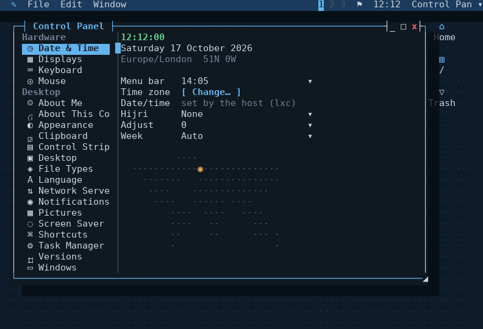
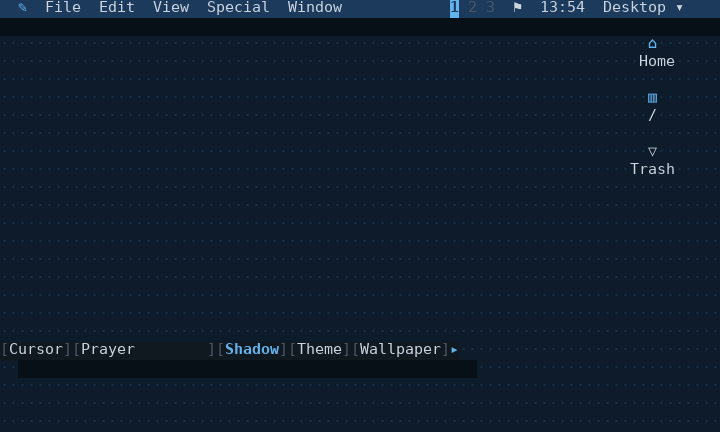

# Windows on a console

hibr can put draggable windows on a text terminal, with apps written as
ordinary hibr functions. Nothing here is new C beyond the display module and
sixty lines of stacking in it: the window manager itself is a script, and so
is every app.

**New to it?** [Your first hour with the desktop](../../docs/desktop.md) is
a short tour, with pictures. This page is the full guide to using it;
writing an application, a Control Panel pane, a strip module or a session
of your own is [WRITING.md](WRITING.md), and how it works underneath is
[ARCHITECTURE.md](ARCHITECTURE.md).

There are three layers, and they are X's, which is the clearest way to
describe them:

| X | here | what it is |
|---|---|---|
| the server | the `console` module | owns the terminal, the grid, the mouse, stacking, hit testing |
| the window manager | `programs/desktop/desktop.hibr`, sourcing `wm/` and `widgets/` | the event loop, focus, dragging, title bars; the widgets apps draw with |
| `~/.xinitrc` | your own session file | which windows open, and where |

Try it, from a checkout:

    ./build/hibr programs/desktop/session.hibr

Or, once `make install` has put this whole directory at
`$PREFIX/share/hibr/desktop` (`/usr/local` by default) and a small wrapper
at `$PREFIX/bin/desktop`:

    desktop

`desktop --resume` and `desktop --session name --resume` work the same as
running `session.hibr` directly does -- the wrapper forwards its own
arguments straight through, it does nothing else.

An install -- and the package -- holds what `packaging/ships`
names, and what each of those brings (ADR 0047, Gitea #271): the window
manager, the desktop's own `system/` apps, its own Control Panel panes,
the Control Strip modules, the Mystify screen saver, **Files, Terminal,
Stickies, Calculator, Clock, Puzzle and Image Viewer**, and the Classic
theme with the Midnight and Paper colours, in English. An app's pane comes
with its app and goes when it goes. Everything else comes from the
catalogue, and all of it is one command:

    catalogue install apps/

`make install SHIP=all` places everything from this tree instead, for a
machine that will never reach a catalogue, and `make install-extras`
places exactly what the default leaves out. A checkout run with
`session.hibr`, as above, has everything in it either way -- it reads
this directory, not the install.

Drag a title bar to move a window, and any of its four corners to resize
it -- the `◢` at the bottom-right is the one this always had; the other
three work the same way, whichever one is dragged staying opposite a
corner that does not move. `_` minimises, `□` fills the screen, `x`
closes, and holding alt while dragging anywhere in a window moves it
(Control Panel > Mouse). A window being moved or resized follows the mouse
as its **outline**, titled, and goes there and draws once when it is let go;
escape while dragging puts it back. That costs one outline's edge per step
and no frame at all: dragged whole, every step redrew the desktop and sent
the window's whole area, which was about 18 ms and 7.8 kB a step on a
232x71 screen with a picture wallpaper. Control Panel > Mouse > **Drag
Windows** is Outline by default, or Solid to drag it whole as before. Solid
is cheap on a terminal that copies rectangles (DECCRA: Blit from 0.1.589, and
hibr's own emulators): each step goes as one copy of the window, and a window
whose app says nothing in it changed is not drawn again; the wallpaper paints
the strip it left. On the owner's settings, a three-step drag went from 14 kB
to 2 kB, with the window drawn twice instead of five times. A translucent
terminal is still drawn at every step, since its colours are the picture
behind it.
`alt-tab` cycles windows, `alt-w` closes the
focused one, `escape` or `F10` opens the menu bar, and Quit on its hibr
menu ends the desktop and gives the terminal back -- it has no key of its
own by default, so no stray keystroke ends everything. Each of these keys
can be changed, or Quit given one, in Control Panel > Shortcuts. The alt
in every one of the desktop's own is a single setting there, **Shortcut
Key** -- Alt, Super or Alt, or Super -- stored as `mod-` in `DT_KEYS` and
read in one place, `dt_keynorm`; a key you chose with a literal modifier
keeps it. Super reaches the desktop only from a terminal that speaks the
kitty keyboard protocol, which the console asks for and `hold` passes on
to each display that answers.

**Where a new window goes** is Control Panel > Windows > Placement.
**smart**, the default, puts it in the first spot on the display that
overlaps nothing -- scanning from the top left, below the menu bar, clear
of the Control Strip, with room left for each window's shadow -- and where
there is no such spot, where it covers least. **cascade** steps each new
one down and across, as the desktop always did; **center** puts it in the
middle. A window bigger than the display is shrunk to fit. A session's own
`dt_new` with a position is left where it says.

**Snapping** puts the focused window on a half of the display: alt-left,
alt-right, ctrl-alt-up and ctrl-alt-down -- or Window > Snap, which also
has Center. Snapping the same way again puts the window back where it
was. A fixed window can only be centred. **alt-up zooms** the focused
window (alt-up again puts it back) and **alt-down minimises** it, since
0.99.265; a settings file still holding the old snap keys moves with
them, and a key you chose stays. The keys are Shortcuts like any other,
and the Window menu shows each beside its item; Center has none until
you give it one.

**With more than one display**, snapping and **Zoom** act on the display
holding the window's centre, its whole height on a display with no bar
and below the bar on the primary (Gitea #286). Control Panel > Windows >
**Zoom Fills** says `every` to have Zoom fill every display at once
instead, as it did before; snapping always keeps to the window's own
display.

**Workspaces**: three by default (Control Panel > Desktop > Workspaces, 1
to 9), for the whole desktop at once, every window on the one that was
current when it opened. The bar shows the numbers left of the notification
icon, the current one lit; click one to go there, or drag a window by its
title onto one to send it there. alt-1, alt-2 and alt-3 switch,
ctrl-alt-right and ctrl-alt-left step through them (Workspace 4 to 9 have
no key until given one), and so does the mouse wheel over the bare
desktop or the bar -- down to the next, up to the previous, one step a
notch. A terminal gives the desktop every shortcut it holds, because they
are all on alt or ctrl-alt and what a terminal keeps for its program is ctrl
with a letter. Window > Move to Workspace sends the focused window, and a title
bar's right-click menu has the same for its own. Window > On Every
Workspace (or the title bar's right-click menu) makes a window sticky: it
stays in view whichever workspace is current, floats over a tiled one, and
taking it off leaves it on the workspace you see it on -- as does sending
it to one workspace. With one workspace the
bar shows no numbers and none of this appears. Cycle (alt-tab, or
Window > Cycle) goes through this workspace's windows; Control Panel >
Desktop > Cycle Windows On set to `all` goes through every workspace's,
from this one on and round, going to whichever one holds the next window.
The application menu lists every window, marked with its
workspace's number when it is on another; choosing it goes there, and so
does opening an app that is already open on another.

**Tiling** is a workspace's own: Window > Tile Workspace (or its
shortcut, unset until you give it one) and the desktop lays that
workspace's windows out itself -- the main one on the left, Control Panel
> Windows > Tiled Main per cent of the display wide, the rest stacked down
the right -- and lays them out again whenever one opens, closes, hides or
moves between workspaces. Window > Make Main puts the focused window on
the left; dragging a tiled window by its title onto another swaps the two.
A fixed window floats over the layout, and a tiled window cannot be
resized by hand. Turned off, the windows stay where the layout put them.

A button presses then releases, the same as any other clickable thing in a
real GUI: held down, it shows inverted, and dragging off it before letting
go cancels whatever it would have done -- nothing fires until release, and
only if release lands back on the same button.

A double click on the title bar itself does the same as `□` by default --
`DT_DBLACTION`, a Control Panel entry, can change that to minimise, close, or
nothing at all. It never zooms a fixed window, the same restriction `□`
itself already has.

A minimised window has no pane at all, so nothing draws it and nothing can
click it. Its label on the bar across the top is the only way back — click it
to restore the window. The bar also says how many windows are open and how
many are hidden.

A window casts a shadow, darkening whatever it falls across -- another
window, or the desktop underneath. `DT_SHADOW`, a Control Panel entry, turns
it off; it costs a few `console darken` calls per window, and nothing at all
when off.

Its shape is Control Panel > Appearance > **Shadow Shape** (`DT_SHADOWSHAPE`,
Gitea #340), and every shadow takes it: windows, menus, the bar's pop-ups,
the menu bar and the Control Strip.
- **Half Block**, the default since 0.99.286, is half a row below and one
  column right. A cell is about twice as tall as it is wide, so that is as
  thick each way, and thinner. It is a lower half block beside the box's top
  row, one column down its side, and upper half blocks along the row under
  it.
- **Two Columns** is a row below and two columns right, as shadows were
  before 0.99.286.

A half block replaces the cell it is drawn in, so it is drawn only where
nothing can be read: on the wallpaper, its pattern included. Over a window,
or over any text, the shadow dims the whole cell as Two Columns does. The
ASCII glyph set has no half blocks and keeps Two Columns.

An open menu -- a bar menu, a submenu, a right-click context menu, or a
dropdown's own popup -- casts one the same way, governed by its own
`DT_MSHADOW` instead: a menu is drawn far more often than a window moves, so
whether to pay for its shadow is a separate choice from a window's.

The menu bar itself casts a shadow too, one row straight down across the
full width of the screen, giving it a sense of sitting above everything
else -- `DT_BARSHADOW`, a third and separate setting again, since the bar
is drawn every frame it is visible at all (always), which is neither a
window moving nor a menu opening.

How dark a shadow falls is `DT_SHADOW_PCT`, part of the theme rather than one
constant: a theme's `shadow` sets it alongside the other seven colours.
Scaling an already-dark face down by console darken's own default (55, a 45%
cut) is a small absolute change and reads as soft against a dark theme, but
the same cut off paper's near-white face lands on a flat medium grey -- a
hard block, not a shadow -- so paper alone gets a much gentler one.

## Themes and colours

A **theme** is the whole look at once: a colour scheme, and the wallpaper,
window frame, title bar, buttons, checkboxes, shadows and glyph set to go
with it. Appearance > Theme chooses one, and every setting it carries can
still be changed on its own afterwards. Three come with the desktop --
classic (midnight, as the desktop has always looked), construction
(black-and-yellow hazard stripes, yellow windows, double frames, solid
black title bars) and meadow (a sky over a green hill, beige windows with
rounded frames and blue title bars, after the desktops of around 2001).
Appearance > Save Current Look as Theme… writes the look as it stands to
`~/.config/hibr/themes/` under a name you give it, and it joins the list.

A theme is a JSON file too:

<!-- not run: a data file the Appearance pane reads -->
```text
{
  "colours": "hazard",
  "wallpaper": "╱",
  "image": "construction.png",
  "mode": "zoom",
  "frame": "double",
  "titlebar": "solid",
  "buttons": "squares",
  "tree": "plus",
  "treelines": true,
  "checks": "block",
  "dialog": "filled"
}
```

`colours` names a colour scheme and is the one key a theme must have. The
rest, each optional: `wallpaper` (a glyph from Control Panel > Wallpaper's list), `image`
and `mode` (a picture, its path relative to the theme's own folder so a
theme can carry it, and how it is fitted), `frame` (`single`, `double`,
`rounded`, `none`, or `bar` -- the title bar alone, with rounded ends, and
the content to the window's edge), `titlebar` (`line`, or `solid` -- the top
row a bar of the frame's colour), `wintrans` and `bartrans` (how much of a
picture wallpaper shows through a window's face and through the menu bar,
0 to 100 -- Control Panel > Windows and Appearance > Menu Bar each have a
Wallpaper Shows Through slider for them, and a terminal's own setting still
decides inside a terminal when it is above 0), `buttons` (`brackets`, `circles`, `squares`,
`diamonds`, `dashes`), `tree` (`plus`, `arrows`, `triangles`, `dots` --
the marks a collapsible tree wears, so a theme that draws its windows one
way does not leave every tree looking like the one before it) and
`treelines` (`true` or `false`, the rules joining a child to its branch),
`side` (`right`, `left`), `align` (`left`,
`center`, `right`), `checks` (`theme`, `box`, `knob`, `block`), `dialog`
(`filled`, `brackets`), `glyphs` (`unicode`, `ascii`), and `windowshadow`,
`menushadow`, `barshadow` and `buttonshadow` (`true` or `false`). What a
theme leaves out is the desktop's default, so it looks the same whatever
came before it; a value the setting cannot take leaves the file out of the
list whole.

A colour scheme is a JSON file of seven colours and a shadow strength, one
file to a scheme and named for it. The twelve that come with the desktop
are in `programs/desktop/colours/` (installed under
`share/hibr/desktop/colours`); your own go in `~/.config/hibr/colours/`,
which is read first, so a file there named `paper.json` replaces the
bundled paper and any other name adds a scheme. A colour file in
`~/.config/hibr/themes/`, where they all lived before 0.99.33, is still
read as one. Appearance's Colours row lists them all, sorted by name.

<!-- not run: a data file the Appearance pane reads -->
```text
{
  "wall": "#0d1b2a",
  "dot": "#16324a",
  "bar": "#1b3a5c",
  "active": "#63b3ed",
  "idle": "#4a5568",
  "face": "#101820",
  "ink": "#cbd5e0",
  "shadow": 55
}
```

`wall` is the desktop behind everything and `dot` its wallpaper glyph;
`bar` the menu bar; `active` the focused window's frame, the selection and
anything highlighted; `idle` an unfocused frame and dimmed text; `face`
the inside of windows and menus; `ink` the text on it. `shadow` is how much
of a colour survives under a shadow, 1 to 100: 55 is soft on a dark face,
and a light one wants much less of a cut -- paper's is 90. `checks`,
optional, suggests how an on/off choice is drawn -- `box`, `knob` or
`block` (neon suggests `knob`) -- and holds while Appearance > Checkboxes
is left at `theme`; choosing a style there is yours whatever the theme.

A scheme may also set seven colour roles, each optional: `dim` (secondary
text), `selink` (text drawn on the accent, a selection), `good`, `warn` and
`bad` (the traffic-light buttons, an answer, an error, an exit status),
`info`, and `well` (the darker surface keys and cells sit in). One left out
is what the dark schemes share, so a file with only the seven colours
keeps working. Two more, `titlebar` and `titleink`, are the focused window's
frame or title bar and the text on it: left out, they are the accent and
`selink`, which is what every scheme had before them, and Charcoal sets them
so its title bar can be charcoal while its accent is a bright white; paper, phosphor and amber set their own, so a light scheme is
not drawn with dark-scheme greys and the monochrome ones stay one hue. Every colour must
be `#rrggbb` and the shadow a whole number in range, or the file is left
out of the list; a scheme added while the desktop runs appears at its next
start. Why JSON and not a script is
[decision 0028](../../docs/adr/0028-a-theme-is-data.md): a file you were
given can only ever be colours and settings.

## Language

Control Panel > Language chooses the language the desktop speaks. English is
the source, and every other language is a catalogue: `lang/<code>.json`,
in `~/.config/hibr/lang/` or bundled, mapping each English string to its
translation (ADR 0032):

```text
{
 "language": "ar", "name": "العربية", "dir": "rtl", "plural": "ar",
 "strings": {
  "Save": "حفظ",
  "Moved %s to %s": "نُقل إلى %2$s: %1$s",
  "%d files": {"zero": "لا ملفات", "one": "ملف واحد", "two": "ملفان",
               "few": "%d ملفات", "many": "%d ملفًا", "other": "%d ملف"}
 }
}
```

A missing string shows in English, and a broken file is refused whole. The
strings there are to translate are listed in `lang/strings.txt`, kept by
`tools/strings.py --write`; `lang/xx.json` is a pseudo-language marking
every string, for finding one that is not looked up. The same pane holds
Order Right-to-Left Text: on draws Arabic and Hebrew in display order, off
is for a terminal that reorders them itself (ADR 0031).

Mirror Layout, on the same pane, turns the desktop round for a right-to-left
language -- the menu bar from the right edge, a window's buttons on its left,
dialog buttons the other way -- on its own when the language is one (auto),
or on or off whatever the language (ADR 0033). Your own button side and
title alignment keep working inside it.

## Glyphs

Every character the desktop draws that is not plain text -- a border, a
scrollbar, a slider's knob, a sort arrow, a menu's tick -- is named in
`wm/glyphs.hibr` and drawn by its name, `${GL[vline]}` rather than a
literal `│`. Appearance > Glyphs picks the set: **unicode**, the default,
or **ascii**, which draws the same desktop in plain characters (`+-|`, `#`,
`[ Title ]`) for a terminal or a font without the others -- a Linux
console, an older ssh client -- or **nerd**, for a terminal whose font is
a Nerd Font (FiraCode, JetBrains Mono, Hack... Nerd Font Mono): folders,
files, home, disks, the trash, ticks, stars and flags become the font's own
icons, and everything it has no icon for stays unicode. No terminal can be
asked what font it uses, so this one is chosen, never guessed; with an
ordinary font its icons draw as empty boxes. The icon each app and pane
chooses for itself stays as its own `dt_app` or `cp_pane` line writes it.
**blit** is for Blit's own Retro and Modern fonts (Gitea #330). Those carry
the whole Nerd catalogue, so it is the nerd set, plus the colour icons Blit
drew for hibr, one cell each: the hibr menu's pen, Bluetooth, and Wi-Fi as
four signal levels that stand for the icon and its bars together. With the
nerd and blit sets, the notification icon is the Nerd Font's own for the
style chosen, rather than a text symbol. Blit's icons are private to its
fonts, so the set is a choice, like nerd; anywhere else, pick one of the
other three.

A menu is no wider than **Menu Width** (Appearance > Menu Bar): 40 columns
by default, or 30 to 80, or No Limit. A row longer than that -- a window's
title, a device's name -- is cut with an ellipsis. A menu dropped from the
bar stays on the display the bar is on, shadow and all, rather than opening
onto a display beside it (Gitea #324).

Checkboxes (Appearance > Controls > Checkboxes) are a box `[x]`, a knob,
a block, or a tick `[✓]`, or what the theme suggests.

## The wallpaper

`dt_wall` fills the whole screen before anything else draws: `DT_GLYPH`
repeated (`·` by default, Control Panel > Wallpaper's Pattern row and the
strip's `wallpaper` module both cycle it), or a real picture in `DT_WALLIMG` instead
when one is set. A picture is decoded and drawn by the `img` module
(`mods/img`, `need img` on first use so a desktop that never sets one never
loads it) -- `img draw` blits it straight into the display, resampled to
fill the screen exactly, cached by the module itself so a redraw every
frame does not mean a decode every frame. The two are mutually exclusive in
the UI: picking a glyph clears `DT_WALLIMG`, and a picture wins over the
glyph when both happen to be set. Setting one at all means opening a
picture in the desk accessory `imgview` (drop a file onto it, since there
is no file-open dialog anywhere in this desktop) and choosing "Set as
Wallpaper" from its own **Image** menu. If the file cannot be decoded --
moved, deleted, not actually a PNG -- `dt_wall` falls back to the glyph
rather than leaving the screen blank.

How a picture wallpaper is drawn is its own setting, Control Panel >
Wallpaper > **Picture** (`DT_WALLIMGMODE`): Follow, which is whatever
Control Panel > Pictures says for every other picture, or Half Blocks,
Characters, Grey Blocks or Pixels for the wallpaper alone -- the same five
YouTube's player offers -- with a Drawn Now row saying what Follow comes to
on this terminal. Pixels on a display whose terminal cannot show them is
half blocks there, never a bitmap it cannot draw.

**Each display can have a wallpaper of its own** (Gitea #284). Control
Panel > Wallpaper opens on **All Displays**, which is the three settings
above; its **Display** row also offers every display attached now and every
one with a wallpaper saved, and choosing one makes the Image, Mode and
Picture rows that display's. Its first change gives it a record of its own,
starting from what it showed until then, and **Delete** on the Display row
forgets the record, so it follows All Displays again. The pattern is the
whole desktop's and is only offered under All Displays.

A display is remembered by its name: `--name` if it was started with one,
otherwise the machine it connects from -- the ssh client's short host name,
or its address when that does not resolve -- or, for a terminal on this
machine, its terminal program (`dt_dispname`). Two terminals on one machine
get one name, and so share a wallpaper unless one is given `--name`; hold
needs every attached display's name to be different, since the Displays
pane moves, drops and makes primary by name, so the second attaches as
`laptop#2`, and what is remembered is looked up by the part before the
`#`. The records are `dt_walldisp name image mode picture` lines in the
settings file. A theme's picture, the Image Viewer's Set as Wallpaper and
the Control Strip's wallpaper module set All Displays, so a display with a
wallpaper of its own keeps it. A desktop joined from a terminal window
inside another held session inherits that session's `SSH_CONNECTION`, and
so is named for the machine that session came from; give it `--name`.

## Icons on the desktop

A clean desktop, down from the top right: **Home**, the mounted **disks** if
`DT_DISKS` wants them (real block devices only -- `/proc/mounts` filtered by
filesystem and by a `/dev/` device, so tmpfs, proc, cgroups and the dozen
other things a kernel mounts never show up as one), and the **trash**, drawn
full when it is not empty. Apps stay in the hibr menu, not here, and nothing
in `~/Desktop` gets an icon just for being there -- the desktop is not a
second copy of a folder. A **double click** opens one: Home and a disk in
Files, the trash in Files on what it holds.

**Choose several**: ctrl and a click adds an icon or takes it away, shift
and a click takes the run from the last one chosen (where the terminal
passes shift-click on; many keep it for their own text selection), and a
drag across the empty desktop draws a band that selects every icon it
touches. With no window focused the keyboard works too: the arrows go from
icon to icon, shift with them extends the selection, space picks or drops
one, ctrl-a takes them all, enter opens what is selected. alt-c copies their
paths.

**Drag** an icon somewhere empty and it stays there, remembered in the
settings file with the rest; drag a selection and it moves together, keeping
its arrangement. Positions are clamped to the screen every time it is laid
out, not just when one is dropped, so a spot picked on a wide screen cannot
put an icon under the bar or off the edge after a resize to a narrower one --
`dt_size` calls `dt_iconlay` on every resize for exactly this. Special >
Clean Up Desktop forgets every saved position and lays them out fresh, for
when they have drifted somewhere inconvenient anyway.

**With no window focused the desktop is the Finder**, and its menus are
System 7's: **File** (New Window, Open what is selected, Find…), Edit,
**View** (Desktop Icons on or off, Refresh) and **Special** (Clean Up
Desktop, and Empty Trash…, which asks first and then deletes for good).
Every app with menus of its own puts File and Edit first in the same way.

**About follows the front app, and there is only one of it.** The hibr menu's
first item is *About Files…*, *About Calendar…* -- whatever is in front, a
helper window such as Calendar's event editor answering for its app -- and
*About This Computer…* when the desktop itself is, which is the window with
the machine's own numbers in it. One item that changes, rather than two at
once: with an app in front, About This Computer is reached by clicking the
desktop first. An app that defines `<app>_about` shows its own; any other gets
the desktop's card: its icon and name, the line its `app` declaration
describes it with, the file it came from, and the shell's version.

**Home and a disk are never something delete or a drag can lose.** They are
a kind of their own, `place`, deliberately left out of every path a move or
a trash can act on -- dragging Home onto the trash icon, or pressing delete
with it selected, does nothing, on purpose: dragging Home into the trash
used to mean the whole home directory, moved. Copying a place's path with
alt-c is still allowed, since that only ever produces text. Icons can be
switched off in Control Panel (`DT_ICONS`), and the disks specifically with
`DT_DISKS`, or with either in the session.

## Open, Save As and Export

One dialog does all three, in every app: a folder's contents, folders first,
only the kinds of file the app works with -- the Type dropdown shows the
others, and All files -- and beside the list a preview of what is selected,
a text file's first lines or a folder's count. Arrows move, enter opens a
folder or chooses a file, backspace goes up, `~` goes home, and a `/`
starts typing a path. Save As adds the type's extension when the name has
none and asks before replacing a file; each app comes back to the folder it
last used. Write's Open…, Save As… and Export… (HTML, or plain text as it
reads) and dBASE's New Database… and Open Database… are this dialog; an app
asks for it with

<!-- not run: a desktop function, called from an app's menu -->
```sh
dt_filepick save "Export" "HTML:html htm|Plain text:txt" "$dir" "notes" my_export "$id"
```

and is called back as `my_export id path type`.

## Open With, and a terminal in a folder

Right-click a file in Files and **Open With** lists every app that can open
it -- the one a double-click uses first, marked default, then the others,
then **Other…**, which takes a command and runs it on the file in a
terminal. Choosing one opens the file there this once; nothing is
remembered. Control Panel > File Types has an **Open With** row for each
type: tick the apps it lists, press d on the one that should be the
default -- what a double-click does from then on -- and Save, or Reset to
go back to every app in its usual order.

**Open Terminal Here** opens a terminal whose shell starts in the folder
right-clicked, or in the one shown. Control Panel > Files can take either
item off the menu, and sets the shell Terminal Here starts: your `$SHELL`,
or hibr, bash, zsh or sh.

An app that opens files says which, so it is offered:

<!-- not run: a line from a desktop file, read when the desktop loads it -->
```sh
dt_opener imgview "Image Viewer" "png ans" app imgview
```

`dt_opener <name> <title> <extensions> app|edit|run [app] [dir]` -- the
extensions space-separated, `*` for any file and `x` for one that may be
run.

With `dir` after the app, the extensions are a **folder's**: a bundle, a
folder that is really one thing -- a game, a notebook, a photo library
(Gitea #318). Files shows `Prince of Persia.boxer` as one item with a
glyph of its own, Enter and a double click hand its path to the app, and
Open With lists every opener that takes it. Its right-click menu also has
**Show Contents**, which goes in, because a bundle is still a folder and
`ls`, `cp -r` and `tar` see one. An app can add verbs to that menu, each
opening an app of its own with the bundle's path:

<!-- not run: lines from a desktop file, read when the desktop loads it -->
```sh
dt_opener boxerplay "Boxer" "boxer" app boxerplay dir
dt_openerverb boxer "Get Info..." boxerinfo
```

An extension nobody registered, or one whose app is not loaded, is an
ordinary folder.

A folder can carry its own picture (Gitea #336). In the icon view, on a
terminal that draws pixels, a bundle shows its `.cover.png`, or failing
that its `cover.png`, as its icon. An ordinary folder shows its
`.cover.png`; only the dot-file counts there, so a stray `cover.png` in a
folder is not taken for its cover. Boxer's games carry one already, and an
album, a photo set or a project gets one by dropping a PNG in. A listing
with any cover lays its tiles out 7 rows high, each picture 5 rows by 10
columns in its own shape, or keeps the 3-row tile with the picture in the
glyph's place: Control Panel > Files > **Cover Size**, Large or Small;
**Use Covers** off draws glyphs everywhere and leaves the pictures be. A
folder with no cover, one whose picture does not decode, a terminal that
draws no pixels, and the list and details views all show the glyph as
before. Each folder is checked with one file test, once per listing.

## Files between windows

Drag a file out of a Files window and let go over another: over a Files
window it goes into the folder shown, or into the folder it was let go on;
over a terminal window its path is typed in, quoted for a shell. A drop
**moves**, and **copies with ctrl held**. Nothing is ever put over something
already there, and a folder cannot go inside itself -- the desktop says so
instead. Escape while dragging cancels.

A selection drags whole: every file in it moves or copies, and one note
says how that went -- "Moved 3 items to project", or the first thing
refused and how many more were.

An app starts a drag with `dt_dnd label glyph path...` from its `_mouse`,
and takes one with `_drop`; the moving and copying is `dt_fileop`, once, so
every app refuses the same things. `dt_trash path` moves a file to the trash
at `~/.local/share/Trash`, the freedesktop one, so what is thrown away here
turns up in any other desktop's trash on the machine. `dt_openfile path`
opens a folder in Files, a registered handler if one matches the name's
extension (see **Application handlers** below), and anything else in a
terminal with hvi.

**Right-click** an entry, or empty space in the list, for a menu of its
own: Open, Open With (only when a handler is registered, listing every one
by the program it runs), Cut, Copy, Paste, Info, and Move to Trash --
dimmed for what does not apply to the entry under the pointer, or to `..`.
Cut marks the clipboard so the next Paste moves the files instead of
copying them; Paste itself, and the note it leaves, say which happened.
The desktop's own background and every window's title bar have their own
right-click menus too, unrelated to this one -- Arrange Icons and Change
Wallpaper on the desktop, Move/Resize/Zoom/Hide/Close on a title bar.

In the file browser a click selects one entry; ctrl and a click adds or
takes away; shift and a click takes a run; shift with the arrows carries
the selection along; space marks the entry under the cursor and steps on;
ctrl-a takes everything but `..`. A plain click on something already
selected keeps the rest until the button comes up, so the selection can be
picked up and dragged; the footer says how many are chosen.

The file browser has three views, which `v` cycles and the View menu picks:
a **list** of names; **details**, with size, time and permissions from one
`ls -l` per folder, dropping columns from the right as the window narrows;
and **icons**, a grid the arrows move across and down. Delete moves the
selection to the trash; alt-c copies its path, and alt-v in a Files window
copies the file whose path was pasted into the folder shown.

## Copy and paste

**alt-z** undoes and **alt-y** redoes in anything that edits text, and
Select All is on the Edit menu beside them.

**alt-c** copies, **alt-x** cuts, and **alt-v** pastes, in every window --
each a key you can change in Control Panel > Shortcuts, and the change
applies everywhere at once -- and all three are on the **Edit** menu, which
shows the key each has now. The menu belongs to the desktop like Window
does: the same three items everywhere, dimmed where the focused app cannot
do them -- most apps have no Cut, since most things there are not files. An
app offers `<app>_cut` the same way it offers `<app>_copy`, and its
`<app>_paste` is handed a third argument, `cut` or `copy`, so the file
browser is the one thing so far that tells them apart. There is one
clipboard for the whole desktop, and a copy or cut also goes to the
clipboard of the terminal the desktop runs on through OSC 52, so it pastes
into anything else on the machine -- where that terminal allows it, which
most modern ones do and some ask about first. A held desktop sends it to
every terminal attached, so with a second machine joined (`--join`) a copy
lands on both machines' clipboards.

**A one-line text field has all three whether or not its app wrote them.**
A field's value belongs to its app, so there is no way for the desktop to
write into one -- and the answer is that it does not need one: every field
in the desktop is drawn with the same widget and applies keys with the same
`dt_textkey`, so a paste is the clipboard's own characters handed to the
focused window as keys, and a cut is ctrl-u then ctrl-k, which that widget
already means as "to the start" and "to the end". Nothing per app, and
nothing extra to keep in step. Until 0.99.178 a text box had a clipboard
only if its app had written one -- eleven of the twenty files that draw a
field could paste, none could copy or cut, and the Control Panel, which
holds more fields than anything else, had none of the three.

Such a field has no selection, so **Copy is the whole of it** and Cut is
the whole of it and empty. A paste longer than a thousand characters is cut
to that and says so, since a one-line field holding a copied document is no
use and losing the rest quietly is worse.

What each app copies and takes:

| app | copies | a paste |
|---|---|---|
| Terminal | the text dragged over | is typed into the program |
| Stickies | the text selected -- shift with the arrows, home and end, ctrl with them for words, or a drag | goes in at the cursor, over any selection |
| Files | the selected files, as paths | of paths copies (or after Cut, moves) those files here; of other text saves it as `Pasted text.txt` |
| Image Viewer | the picture, as its file | -- |
| Calculator | its answer | of arithmetic is taken as input |
| dBASE | the line being typed, at the prompt or in an APPEND field | goes in at the cursor |
| Sheet | the selected cells, tab-separated, each as it was typed (a formula as its formula) | of tab-separated lines fills the grid from the cursor |
| every dialog's text field -- Rename, Get Info, File Type, Clock Format, Set Date & Time, Time Zone, Screenshot Folder | the whole field (cut empties it) | goes in at the cursor, on one line |
| Task Manager | the selected process, its pid and name | -- |
| Modules | the selected module, its version and its path | -- |
| Process Details, About | what they show | -- |
| Notifications | the selected note (cut also clears it) | -- |
| Clock | the time and date | -- |

**Everything copied is kept.** The **Clipboard** desk accessory lists it,
newest first: when it was copied, ★ on what is pinned, • on what is on the
clipboard now. Enter makes one the clipboard again, p pins it -- pinned
ones are never dropped -- and delete removes it; pasting into the
Clipboard keeps what was pasted, to come back to later. The last 50 are
kept between desktops, in a file in the state folder only you can read;
Control Panel > Clipboard sets how many, or keeps none on disk at all, and
clears the history (pins stay).

A paste from the machine itself -- the terminal's own paste, cmd-v or
ctrl-shift-v -- goes to the focused window and also becomes the desktop's
clipboard, so alt-v pastes it again anywhere, on any display. A program
inside a Terminal window can set the clipboard too, with OSC 52 -- vim's
`"+y` with a clipboard provider that uses it, tmux's `set-clipboard` -- and
it reaches the desktop and every attached machine; Control Panel >
Terminal > Programs Set Clipboard switches that off. A program asking to
*read* the clipboard is never answered.

Closing a Terminal window that still has a command running in it asks
first, since closing one kills whatever holds the pty -- an editor with an
hour in it, a build half done. Sitting at the shell's own prompt is not
"something running": the question is whether the pty's foreground process
group is still the shell's, which an idle prompt leaves it and a command
does not, so a window with nothing going closes without a word. Control
Panel > Terminal > Ask Before Closing turns the question off.

Control Panel > Terminal > Copy on Select copies a terminal's text the
moment the mouse lets go of it, as xterm does, without alt-c. What was
copied stays lit, and the next key only puts the highlight out -- it is not
sent to the program, so an enter pressed out of habit after copying does not
run whatever is half typed on the line.

Text is what crosses between a machine and the desktop. Files and pictures
copy and paste as files inside the desktop, but a picture or a file on a
machine's own clipboard cannot reach it: a terminal carries text only.

## Folders on servers

Files reaches a WebDAV server -- Nextcloud, ownCloud, a NAS, Apache or
nginx DAV, rclone, anything that speaks it -- as though it were a folder
here. **Servers > Connect to Server…** in Files (or **Add Server…** in
Control Panel > Servers) asks for a name, the server's address,
a user and a password, and whether to check its certificate; **Test**
tries what is typed before anything is saved. For Nextcloud the address
is `https://HOST/remote.php/dav/files/USER`, and an app password is the
one to give it. Every server is then on the Servers menu, and Files
shows it as `NAME:/` in its title.

In a server's folder Files does what it does anywhere: enter goes in,
backspace comes back, `n` renames, **New Folder** makes one, Get Info
shows the size, time, type and ETag. Dragging, Copy and Paste work
between a server and a local folder in either direction, and between
two servers; nothing is ever put over something already there. A
transfer runs in the background with a note when it starts and one when
it ends, so a large file never stops the desktop. There is no trash on
a server, so delete asks first, and what it removes is gone.

Opening a file on a server fetches a copy into
`~/.cache/hibr/dav` and opens that, in whatever opens the type. While
**Upload Edits on Save** is on (Control Panel > Servers), saving
the copy puts it back -- but only over the version it was fetched as.
If someone changed the server's copy in the meantime, the edit goes up
beside it as `name (conflict DATE).ext`, and a note says so; nobody's
work is overwritten. **Clear Cache** empties the copies, keeping any
edit not yet saved to its server.

Servers are kept by the dav module in `~/.config/hibr/dav`, readable
only by its owner; the Control Panel and the dialog never show a
password, and leaving the field empty when editing a server keeps the
one it has. How long a server may take is **Timeout** in the same pane.
See [mods/dav](../../mods/dav/README.md) for the module itself.

## YouTube

**YouTube**, in the Internet folder, searches YouTube and plays what it
finds in a window: the picture as coloured half blocks (or ASCII), the
sound through the machine's own device. Type a search and press enter;
up and down choose, enter plays. While playing: space pauses, left and
right are five seconds (with shift thirty), up and down the volume, `m`
the picture, escape back to the list, and a click on the bar goes there.

**The mini player**: `i`, Play > Mini Player, or a double click on the
picture shrinks the player to the picture alone -- no border, title or
bar -- in a small window at the bottom right, on every workspace. Drag it
anywhere; a right click has the player's controls (pause, seek, next,
louder, quieter), Full Player and Close; a double click or escape goes back
to the full player where it was.

A search lists playlists and channels as well as videos; enter on one
shows its videos under its own title, and escape goes back to the list
before. Typing or pasting a playlist's, a channel's or a video's address
opens it directly. In the player `n` and `p` play the next video in the
list and the one before, and at the end of one the next plays by itself
(Play > Play Next Automatically). Everything watched goes in a history
(`h`, or Go > History) with where it was left, and choosing it again takes
it up there; `f` keeps a video, a playlist or a channel as a favourite,
starred in every list, and `v` lists them. Both are files of their own in
`~/.local/share/hibr/youtube/`.

YouTube's own page does the fetching, in the web module's headless
Chromium: its player is asked for its lowest quality -- plenty for a
window of cells -- and muted, and every chunk it plays is copied into a
media player here, which decodes it with FFmpeg's libraries. So it needs
Chromium or Chrome and FFmpeg's libraries, and it follows YouTube's own
player wherever YouTube takes it -- including its ads, which come through
the same way. YouTube's player can still give up part way -- its own
"Something went wrong" -- or not start at all; the app notices within a few
seconds, loads the video again and takes it up where it was, and says so,
and only after three tries in a row does it stop and tell you. Control
Panel > YouTube sets the picture, the quality asked
for, and how many frames a second are drawn and how finely, which decide
how much a terminal is sent; whether the next video plays by itself; and
Clear History.

## Mail

**Mail**, in the Internet folder, is a mail client laid out the way Gmail
is: Compose and the views down the left -- Inbox, Starred, Important, Sent,
Drafts, All Mail, Spam, Trash, then the account's labels or folders, each
with its unread count -- and the conversations on the right, newest first,
a message and its replies together, whoever wrote them and how many, the
subject and the start of the latest. Enter or a click opens one: every
message in it, oldest first, each with its sender, date and recipients,
HTML laid out (headings, lists, quotes, tables, links you can click) and
attached pictures drawn in place; attachments are buttons that save the
file. Pictures from the web are never fetched -- that is how a sender
learns a message was opened.

Gmail's keys work: `j` and `k` move, `o` or enter opens, `u` or escape goes
back, `e` archives, `#` moves to Trash, `!` to Spam, `s` stars, `I` and `U`
mark read and unread, `l` gives a label, `v` moves, `c` writes a new
message, `r` replies, `a` replies to everyone, `f` forwards, `/` searches
(every word, in sender, recipients, subject and text), `R` checks now, and
`g` then `i`, `s`, `t`, `d` or `a` goes to Inbox, Starred, Sent, Drafts or
All Mail. The File, Message and Go menus have them all.

A message being written is **saved to the account's Drafts folder**: by
hand from File > Save as Draft, by itself once it has been left alone for
Control Panel > Mail > Save Drafts Every seconds (0 turns that off), and on
the way out when its window is closed with something still unsaved. Each
save takes the one before it away, where the server names what it appended
(IMAP's UIDPLUS, which nearly every server has); a server that does not
leaves the older copies behind, which is its own limit rather than
something to paper over. Opening a draft from Drafts takes it up to be
finished -- the same window Compose uses, filled with its own addresses,
subject and words -- rather than opening it to read. Discard throws away
both the window and anything already filed for it.

It works offline. A job of its own (`programs/desktop/lib/mailsync.hibr`,
on the `email` and `db` modules) keeps each account in
`~/.local/share/hibr/mail/<account>/`: a row a message in a `db` file, and
the newest messages' whole text beside it. What you do -- read, star,
archive, label -- happens at once on screen and goes into a queue the next
sync sends; when there is no connection the queue waits, and nothing is
lost if a connection drops part way. New mail arrives by itself: the app
keeps an IMAP IDLE open on the inbox, so it is pushed rather than polled,
and checks everything every few minutes as well.

IMAP is the whole of it, Gmail's labels included -- archive takes the Inbox
label off, as Gmail does. A POP3 account works too, with what POP3 allows:
new mail is downloaded and kept here, read, starred, archived and labelled
are this machine's own, Trash and Spam are folders here, a message put in
Trash is deleted from the server as well, and what you send is kept in a
Sent folder here. Sending is SMTP.

Control Panel > Mail adds and changes accounts -- for Gmail or Outlook the
address and a password are enough; Gmail wants an *app password*, made in
the Google account's security settings, since there is no Google sign-in
here -- and sets how many messages are kept offline (1000 unless changed:
the main folder gets that many, every other folder a fifth of it), how many
are downloaded whole, how often to check, whether attached pictures are
shown, and a signature. Accounts are the `email` module's private file,
readable only by you; the pane never shows a password.

How big a mailbox stays quick is measured, not hoped: with 1000 messages
kept, opening the app reads them in 0.2 s and changing view takes about
0.35 s. Many more than that and every action slows, because the shell's
maps are lists -- which is why the Keep Messages choices stop at 2000.

## Contacts

**Contacts** keeps the people in your address books on this machine, from
any CardDAV server -- Nextcloud, Fastmail, iCloud, Radicale. A list down
the left, searchable with `/` (every word, in names, emails, phones and
organisations), and the person chosen on the right: their emails -- a
click on one, or `m`, writes to them in Mail -- phones, organisation and
note. `n` adds someone, `e` or enter edits, `#` or delete removes after
asking, `R` syncs now; the File and Contact menus have the same.

A server is one of the Servers (Control Panel > Servers:
its address and an app password), switched on for this in Control Panel >
PIM, which also says how often to sync. One list of servers serves Files as
well, since a Nextcloud or Fastmail account is one address and one login for
files, calendars and contacts; PIM asks each server once what it keeps and
lists a plain file server as files only, so only servers with calendars or
contacts can be switched on. Add Server… there opens Servers. A background job
(`programs/desktop/lib/pimsync.hibr`) finds the address books from the
server's `.well-known` address, keeps each up to date with its sync token,
and is the only thing that writes the copy in
`~/.local/share/hibr/pim/SERVER/`. It runs every so often whether or not
Contacts or Calendar is open (`programs/desktop/lib/pim.hibr`, which both
share). An edit or a new contact happens in the
list at once and goes to the server at the next sync -- only if the
server's copy is still the one it was read from; if someone changed it
meanwhile, theirs wins and the next sync brings it.

Mail uses the same copies: typing in To, Cc or Bcc offers the people who
match -- from Contacts and from everyone Mail has had a message from --
and tab or enter takes one; Message > Add Sender to Contacts adds whoever
wrote the conversation chosen.

## Calendar

**Calendar** keeps your calendars on this machine from the same servers,
by CalDAV, a month at a time: each day's events in its square, in its
calendar's own colour, and the chosen day's events listed underneath with
their times. The arrows choose a day, `n` and `p` (or page down and up)
change month, `t` comes back to today, `a` shows an agenda of the next
sixty days and `m` the month again. `tab` moves into the day's list, where
enter or `e` edits the event chosen and `#` removes it after asking; `c`,
or enter on the month, makes an event on the chosen day.

An event has a title, a date, a start and an end (or all day), a repeat
(daily, weekly, monthly, yearly), a reminder, its calendar, a place, notes
and who is invited. It is written in this machine's zone -- `TZ`, or where
`/etc/localtime` points -- and sent at the next sync, like a contact.
Reminders go off as notes whether a Calendar window is open or not.

With people in Invite, saving also mails each of them an invitation from
your first Mail account, the event inside it as a calendar request any
mail program understands. An invitation that reaches you shows in Mail as
a card -- what, when, where, from whom -- with Yes, Maybe and No: the
answer is mailed to the organiser and the event kept in your calendar
(unless the answer is no). An answer to one of your own invitations
offers to record it in your copy, and a cancellation to remove it.

## Sound

The machine's sound is the desktop's (Gitea #306): a speaker on the menu
bar shows the volume of the output in use -- `♪ 50%`, or `♪ ✕` muted --
and a click opens the volume beneath it as a slider: the level, a track to
click or drag the thumb along, and the speaker at its foot, which mutes;
the wheel over it, or the arrow keys while it is open, step the volume, and
escape or a click anywhere else closes it (Gitea #310). A right click opens
the sound menu instead: the level, Volume Up, Volume Down and Mute with
their keys, the outputs and the inputs with the one in use ticked, and
Sound Settings…; the wheel over the speaker itself turns the volume too.
`alt-=` and `alt--` turn it up and down a step, `alt-0` mutes, each saying
the level in a note -- rows in Control Panel > Shortcuts, like every key
the desktop holds; a keyboard's own volume keys never reach a terminal.

**Control Panel > Sound** has the Sound System -- Auto, PulseAudio,
PipeWire, ALSA or None -- the server it found (or that the one chosen is
not answering), the output Device, its Volume and Mute, the input Device,
its Level and Mute, Volume on Menu Bar, Level on Menu Bar (off shows the
speaker without the percentage), and Volume Step (how far a key or a notch
moves it, 5% unless set). Choosing an output makes it the default and
leaves the input where it was, and what is already playing moves to it --
hibr's own sound included, which plays to the server's default output.

Auto takes the first that answers: a server answering `pactl` (PulseAudio,
or PipeWire with its PulseAudio side), then **PipeWire itself through
`wpctl`** -- what a machine with PipeWire and no `pipewire-pulse` has --
then ALSA's mixer. The desktop watches the server's events (`pactl
subscribe`, or PipeWire's `pw-mon`), so a volume another program sets, or
a headset plugged in, reaches the bar with nothing pressed, an idle desktop
asks nothing, and a burst of changes is read once a second at most. With
ALSA alone, the output and the input are a card each in `~/.asoundrc`,
chosen apart, and the level is the card's Master or Capture, or the first
control it has of that kind -- written only into a file this desktop
wrote, or none, never over one of your own. The sound menu, and any menu a
bar item opens, opens under the bar on the primary display, wherever that
display sits. macOS is not done yet (CoreAudio). `HIBR_SOUND` overrides
the setting -- `pulse`, `pw`, `alsa` or `none` -- and the test suites start
every desktop with `none`, so no test can touch a machine's real sound.

## Network

The machine's network is the desktop's too (Gitea #311). An item on the
menu bar says what it is on: Wi-Fi's four signal bars, as `nmcli` draws
them, a cable (`⇌`), or no network (`✕`). A **left click** lists the
Wi-Fi networks in reach beneath it -- the one in use first and ticked, the
rest strongest first, a key (`⚿`) on each that asks for a password -- with
Wi-Fi's own switch at the top and Network Settings… at the foot; a click on
a network joins it, and so do the arrows and enter. A **right click** opens
the network menu: what the machine is on, Wi-Fi on or off, the networks in
reach, Disconnect, and Network Settings….

Joining runs in the background, so the desktop goes on while a network
comes up, and a note says when it has or why it could not. A network you
have joined before is joined through the connection NetworkManager already
keeps for it -- a new one is never made beside it. An open network is
joined at once. A secured one never joined before asks for its password in
a small window, starred as it is typed, with Show the password beside it;
the password goes to NetworkManager through `nmcli`'s own connection
editor on its standard input -- **never on a command line**, where `ps`
would show it to every user on the machine -- and NetworkManager keeps it.
The desktop writes it nowhere. A wrong password leaves nothing behind: the
connection made for it is taken away again. WEP and enterprise networks
(a username and a certificate) are not joined from here, and say so.

**When the system wants your password.** NetworkManager asks polkit
whether you may do each thing, and from a session that is not the
machine's active local one -- a remote login, a held session -- polkit
usually answers "a password first". A terminal session has no one to ask
it, so the desktop is the one: while a join, a Disconnect, a Forget or
Look Again runs, it keeps polkit's own text agent (`pkttyagent`) on a pty
of its own and, when polkit asks, asks you in a window -- what is wanted,
and whose password -- and hands your answer to the agent, never on a
command line. A wrong one is said as such. Opening the list never asks:
where a scan wants a password the list shows the networks NetworkManager
already knows, and Look Again is the scan. Where polkit refuses outright --
from your own session it refuses Wi-Fi's switch -- the switch is shown
locked rather than offered, and where a connection for everyone may not be
saved but one for you may, a new network is saved as yours alone. An agent
the session already has, a graphical one, is used instead and this one
stands aside (`--fallback`).

**Control Panel > Network** has the Network System -- Auto, NetworkManager
or None -- and what manages the network now; what the machine is on, its
device, address, gateway and name servers; Wi-Fi on or off, Disconnect,
the networks in reach to join and Look Again; the networks it knows, each
by the name NetworkManager gave it and the network it joins, with Forget,
which asks first; and Network on Menu Bar. The WebDAV servers that used to
be called Network Servers are **Servers** now.

Auto takes NetworkManager when it answers, and otherwise iproute2's view
of the default route alone -- wired or wireless, the address and the
gateway, and nothing to join a network with. The desktop watches
NetworkManager (`nmcli monitor`), so a network joined elsewhere, or a cable
pulled, reaches the bar with nothing pressed, and a burst of changes is
read once a second at most. macOS is not done yet. `HIBR_NET` overrides
the setting -- `nm`, `ip` or `none` -- and the test suites start every
desktop with `none`; `tests/net.py` gives its own a stand-in `nmcli`
whose answers are captured from a real one.

## Bluetooth

Bluetooth is the desktop's too (Gitea #312). An item on the menu bar shows
Bluetooth's sign (`ᛒ`) with how many devices are connected -- `ᛒ 2` -- or
that it is off (`ᛒ ✕`). A **left click** lists the devices it knows, the
connected ones ticked with their battery where they say it (`85%`), and
under them any a scan has found, to pair; a click connects a device,
disconnects a connected one, or pairs one in reach, and so do the arrows
and enter. Bluetooth's own switch is at the top and Bluetooth Settings… at
the foot. A **right click** opens the Bluetooth menu: how many are
connected, Bluetooth on or off, the devices, and Look for Devices.

Pairing pairs, trusts and connects, one after the other, in an interactive
`bluetoothctl` the desktop keeps on a pty of its own with an agent
registered: a device that shows a passkey asks whether it is the same
number, with Yes and No; one that wants a PIN or a passkey typed asks for
it; one that shows a number to type on itself -- a keyboard -- says which.
A wrong PIN says it could not pair and leaves it as it was. Connecting,
disconnecting, scanning and forgetting run in the background, with a note
when each is done or why it was not -- in words: "not allowed from this
session" for what BlueZ refuses, "is it on and near?" for a device that did
not answer.

**Control Panel > Bluetooth** has the Bluetooth System (Auto, BlueZ or
None), the adapter's name and address, Bluetooth and Visible to Others; My
Devices, each connected (with its battery) or not, a click to connect or
disconnect it, and Forget a Device, which asks first; Other Devices, found
by Look for Devices, each a click to pair; and Bluetooth on Menu Bar. The
desktop keeps a `bluetoothctl` running with nothing to read and watches
what it prints, so a device connected elsewhere reaches the bar with
nothing pressed. macOS is not done yet. `HIBR_BT` overrides the setting --
`bluez` or `none` -- and the test suites start every desktop with `none`.

## Power

A machine with a battery has it on the menu bar (Gitea #365): its level and
its charge -- `▄ 62%` -- with `↯` in front while it charges, read from the
kernel's own files every half minute. A click opens the battery's menu: the
charge in words, with the time left or the time to full, then Sleep,
Hibernate (where the machine can), Restart… and Shut Down…, and Power
Settings…. The same three are at the foot of **Special** too.

They act through logind, which needs no root for the person at the machine,
and only where the desktop *is* the machine's own -- a local session on a
seat. A desktop reached over SSH, or one inside another's terminal, dims
them: Shut Down there would turn off a computer nobody at it asked to turn
off. Restart and Shut Down ask first.

**Control Panel > Power** shows the charge, whether it is plugged in, the
battery's health -- what it holds full against what it held new -- and has
Battery on Menu Bar, Low Battery Note (a note once a discharge, at 5 to 25%,
or off), Critical Battery (3 to 10%), and On Critical Battery: nothing, or
sleep, hibernate or shut down after a note and a minute in which plugging in
calls it off. With no battery the pane says so and keeps only the computer's
own actions.

## Screen savers

After ten minutes with no key and no click the screen is given to a
screen saver, until the next key or click -- which ends it and goes
nowhere else, so the key that wakes the screen never lands in a window.
Control Panel > Screen Saver picks which (or one at random) and how many
idle minutes, never included, and shows one now; so does Screen Saver on
the hibr menu. Waiting costs nothing: the desktop is told to wake when
the time is up, as it is for anything else it waits for. A video playing
in the YouTube player keeps the saver -- and so the lock, which follows
it -- away until it is paused, stopped, finished or minimised; Control
Panel > YouTube > Keep the Screen Saver Away While Playing turns that off.

There are six: **Matrix** rain, **Flying Toasters**, a **Classic Mac**
drifting about with its little screen going from the happy face to a
desktop to a window, **Pipes**, **Mystify** and a big **Clock** that
moves every minute. Each is a file in `savers/` that names itself with
`sv_saver` and gives a `_start` and a `_frame`; a new one is one more
file. A saver of your own goes in `~/.config/hibr/savers/` -- listed in
Control Panel beside the bundled ones, and one with a bundled saver's
name replaces it -- and needs nothing else:

```text
command -v sv_saver > /dev/null && sv_saver mine "Mine" 200
fn mine_start(int rows, int cols) { :; }
fn mine_frame(int rows, int cols) { console put 3 3 "hello"; }
```

They run on their own too, by name or a saver file by its path -- the way
to try one while writing it:

```text
hibr programs/desktop/savers/saver.hibr matrix
hibr programs/desktop/savers/saver.hibr ~/.config/hibr/savers/mine.hibr
```

## Locking the screen

Lock Screen on the hibr menu, or its shortcut (ctrl-alt-l, changed in
Shortcuts like any other), puts the screen saver on and keeps the desktop
behind it until your password is given. A key or a click shows a box over
the saver with your name and a password field -- a letter typed at the
saver is already the password's first -- and enter checks it. Escape puts
the box away. A wrong password holds the box for two seconds before the
next try. While locked no key reaches the desktop: not Detach, not Quit,
not any shortcut. A held desktop someone attaches to while it is locked
is still locked.

Control Panel > Screen Saver > Lock After locks on its own a number of
minutes after the saver starts -- "at once", or never, which is the
default. Preview never locks.

The password is checked through PAM by the `auth` module, as you, with no
privilege: checking your own password is what PAM's own helper is for,
and hibr is never setuid. The Debian package installs `/etc/pam.d/hibr`
for it (the system's usual password rules); without that file the lock
asks PAM's `login` service, or `screensaver` on macOS. With no PAM at all
Lock Screen says so and does not lock -- a lock nobody can open is worse
than none.

What it cannot do: it locks this desktop, not the machine. Anyone who can
reach another terminal, a text console or a login on the same machine can
still use it there. Detach the desktop and log out for that.

## Logging in

`login/login.hibr` is a login screen for a text terminal, in place of
getty: a screen saver always behind it, and on a key a box asking for your
user name, then your picture, your name and your password, and whether to
start the **Desktop** or a **Shell**. Tab (or the arrows) changes the
choice, and the one you log in with is remembered for next time. Escape
goes back a step; a minute with nothing typed brings the saver back. When
the session ends the screen comes back for the next person. Root cannot log
in here. It is Linux only.

The Debian package ships it **switched off**. To put it on tty2:

```text
sudo systemctl enable --now hibr-login@tty2
```

and `sudo systemctl disable --now hibr-login@tty2` gives tty2 its getty
back. Leave at least one getty: a login screen that breaks should never be
the only way in. It checks the password and opens the session through PAM
(`/etc/pam.d/hibr-login`, the same rules as a console login), records the
login in utmp so `who` sees it, and runs the session as you, dropped for
good. What it has to say goes to the journal. Logging in to the Desktop
again resumes the one you detached from: a held desktop outlives logging
out (unless logind is set to `KillUserProcesses=yes`). A Linux console
shows sixteen colours, so a picture there is rough.

Your picture, name and line come from **About Me** -- Control Panel >
About Me, kept in `~/.config/hibr/me.json`:

```text
{"name": "Pat Doe", "line": "Out to lunch", "picture": "~/Pictures/me.jpg",
 "session": "desktop"}
```

It is data, never run, and the login screen never reads it as root: a
child that has become you reads it, and decodes the picture down to a small
image, so a picture or a link pointing somewhere you cannot read shows
nothing. Settings for the screen itself are root's, in
`/etc/hibr/login.json`: `"saver"` (a name, or random), `"title"` (the host
name by default), `"message"` (a line under it), `"service"` (the PAM
service) and `"glyphs"` (`ascii` on a Linux console by default, whose font
has no katakana for the Matrix). They are not in Control Panel, which runs
as you.

To try the screen without root, run it as yourself -- it can then only log
in as you, and starts your session in the same terminal:

```text
hibr programs/desktop/login/login.hibr
```

## Application handlers

`dt_handler ext [term] program args...` says what opens a file of that
extension, from a session's own script -- the same idiom as `dt_app`,
registering something rather than editing a table:

    dt_handler jpg feh
    dt_handler json term less

Without `term` the program is started detached, for anything that draws a
window of its own outside the desktop -- an image viewer, a media player --
which must not be waited for, or the desktop would hang until it closed.
With `term` it runs in a terminal window instead, for anything that reads
one, in place of the hvi a file with no handler opens in. A name with no
extension, or one nothing was registered for, still opens in a terminal with
hvi. The file browser's Open With lists every registered handler by the
program it runs, letting an entry be opened by one other than its own.

In a terminal window, drag with the left button to select; the selection
stays put while more output scrolls past. When the program there has taken
the mouse, hold shift to select anyway, as in xterm. A paste goes in as the
terminal's own paste would, bracketed when the program asked for that. The
calculator copies its answer and keeps only arithmetic from a paste. These
are the only two keys the desktop takes from a program: see the amendment in
[decision 0020](../../docs/adr/0020-windows-are-drawn-not-composited.md).
Right-click opens the terminal's own menu (Copy, Paste, Send Interrupt);
shift-right-click opens it even when the program has the mouse.

**A terminal gives the desktop its shortcuts back.** With Control Panel >
Keyboard > Desktop Shortcuts Win on, as it is by default, a shortcut the
desktop or an app launcher has been given goes to the desktop even while a
terminal has focus, so alt-tab cycles windows from inside one -- if it is a
chord (ctrl or alt with a key) or a function key. A plain key -- `q`, `tab`,
escape -- always reaches the program, and so does ctrl with a single letter
whatever is bound to it: those are the control characters programs read, so
`alt-w` closes any window, a terminal included: every shortcut the desktop
itself acts on is on alt or ctrl-alt, because a terminal never yields ctrl
with a letter. `alt-q` quits the focused application -- every window it has,
not only the one in front.
One window can still be given everything: the Window menu's Pass Every Key,
ticked, is for a program that needs the chord, or a desktop running inside
that terminal.

## Screenshots

**ctrl-alt-g** (Screenshot, in Shortcuts) or **Screenshot…** in Desk
Accessories asks what to take: **Screen**, the focused **Window**, or an **Area**
-- drag it out with the mouse, or move a corner with the arrows, press
enter, stretch the band and press enter again. Whichever was taken last is
chosen already, so the shortcut and enter repeat it; escape cancels.

A screenshot is the screen's own cells, not pixels. **ANSI text** by
default: `cat` it in any terminal and it is there as it was, colours and
all. Or **HTML**, for a browser and for sharing, or **plain text**. They go
to `~/Pictures/hibr` as `hibr-2026-10-02-101530.ans` and the like, and a
Files window open on that folder shows it at once. The note that says so
opens it when clicked: an `.ans` in the Image Viewer, which plays it into a
terminal emulator of its own and shows the cells as they were (double-click
one in Files for the same), anything else as the folder. Control Panel > Desktop sets the
format, which choice the chooser starts on, and the folder, and opens it.
Nothing is in the picture but what was on screen: the chooser, the band and
any notes are taken out first.

## Staying current

**Restart Desktop**, on the hibr menu, replaces the running desktop with
whatever hibr is installed now, in the same process, and carries on where
it was: every window in its place, on its workspace, minimised or not, in
the same stacking order and with the same focus, and the tiling as it was.
A terminal's program does not stop -- the same shell, its variables, its
jobs, what is running in it -- and its screen and scrollback come back with
it. Stickies keep their text, the calculator its sum, Files its folder and
selection, dBASE its database and output, and a game its board; a game in
play comes back paused. Nothing needs screen or tmux around the terminals.

When a newer hibr is installed under a running desktop -- `apt upgrade`
and the like -- a note says so; click it to restart into it. Nothing
happens until you do. Noticing it needs `/proc`, so it is Linux only;
Restart Desktop itself works anywhere. The check rides the bar clock's
own once-a-minute wake, so an idle desktop draws no extra frames for it.

An app keeps its windows' state by naming the maps it holds them in, keyed
by window id:

<!-- not run: a line from an app's file, read when the desktop loads it -->
```sh
command -v dt_keepstate > /dev/null && dt_keepstate stickies SW
```

and, for what a map cannot hold -- a program, an open file --
`<app>_stash id dir` before the restart and `<app>_resume id` after. An app
with neither reopens fresh, in the same place.

What it does not do: a terminal whose program had already ended comes
back with a new shell rather than the exit message; a window whose app is
no longer installed stays closed, and its program, if it had one, is ended
as closing the window would. The `hold` process that a session is attached through
keeps running the hibr it was started with until the session is ended; and
between installing and restarting, a module the running desktop has not
loaded yet would be the new one, which the old shell refuses. Restart soon
after an upgrade.

## When the desktop stops

A held desktop -- which is every desktop started the usual way -- has a
small supervisor beside it. If the desktop dies on a signal, or on an error
its script could not get past, the supervisor writes why into
`~/.local/state/hibr/desktop.log` and starts it again, and the new one puts
its windows back where they were, with a note saying it happened.
Terminals come back with a fresh shell: the program that was running in one
went with the desktop. A desktop that dies within its first ten seconds, or
three times in five minutes, is left stopped, since starting it again would
only repeat whatever is wrong. `DT_SUPERVISE=off` in a session turns this
off. Restart Desktop with terminals open keeps their programs running, and
that desktop runs without the supervisor until it is next started afresh,
since a running program has to stay with the desktop that started it.

What is put back comes from a snapshot the desktop keeps of its windows,
written at most every thirty seconds and only while something is happening.
A SIGTERM or SIGHUP -- the machine shutting down -- is a request to stop,
not a crash: the desktop writes the snapshot then, gives the terminal back
and exits, and the next start reopens those windows once. Quitting removes
it, so a desktop ended on purpose starts empty. A desktop that dies within
a minute of putting its windows back, twice running, starts the third time
without them: the snapshot is kept beside it as `snap-<session>.json.skipped`
and a note says so, since a window whose app cannot come back -- a Browser
over a Chromium that hangs -- would otherwise be restored into the same
failure on every start.

## Detaching, and coming back

The shipped session holds itself, so this is already detachable:

    hibr programs/desktop/session.hibr

**ctrl-\\** detaches, and so does **Detach** on the hibr menu; the desktop
keeps running, terminal windows and whatever runs in them included. Log off,
log in somewhere else, and

    hibr programs/desktop/session.hibr --resume

comes back to it exactly as it was, redrawn in full -- the same command,
with one flag, from anywhere. Closing the terminal or losing an ssh
connection detaches too. Running it again *without* `--resume` while it is
already running does not start a second, independent desktop under the same
name; it says so and leaves the running one alone, since a bare rerun is as
likely to be forgetting it is there as it is to mean "and another one."

For more than one, `--session` names which: `--session work` starts (or
refuses, exactly as above) one called "work"; `--session work --resume`
comes back to it specifically, leaving any other named session alone.
Plain `--resume` is short for `--session desktop --resume`.

Underneath, this is a session held by name -- `hold list` shows every one
running, and `hold kill work` ends that one outright. A session gets this
by calling `dt_autohold` once, before `dt_open`, with the name, whether it
was asked to resume, whether to join one already running beside it, and a
name for this display -- what `session.hibr` passes:

<!-- not run: it starts or attaches to a held desktop -->
```sh
opt -r --resume  resume          "Reattach to it if it is already running"
opt -s --session session str=desktop "Which held session this is"
opt -j --join    join            "Attach beside an already-running one"
opt -n --name    name str        "Name this display"
args "$@"
. desktop.hibr
dt_autohold "$session" "$resume" "$join" "$name"
```

It does nothing, quietly, wherever holding cannot make sense -- no `hold`
module, no real terminal to attach from -- or if starting one fails, so a
session that calls it is never worse off than one that does not: Detach
stays dimmed and the desktop opens in this terminal as it always did. See
[`mods/hold/README.md`](../../mods/hold/README.md) for how holding itself
works, and `hold attach desk`/`hold new desk ...` directly if you would
rather manage that yourself, under a name of your own.

## More than one screen

A second terminal joins the same desktop instead of starting its own:

    hibr programs/desktop/session.hibr --join

It attaches beside the first at the union's current width -- another
monitor for the same desktop, not a session of its own -- and refuses,
saying so, if nothing is running yet to join. The bar, the icon grid, notes
and the control strip stay confined to one display, the *primary* one --
the first to attach, until something picks another -- rather than
spreading across every display a terminal has joined beside it; a window
is unaffected and can sit anywhere across the whole arrangement.

Right-click a window's own title bar for **Move to**, a submenu of every
attached display by name, to hand that window from one screen to another.
The hibr menu's own **Displays** submenu lists the same displays, primary
ticked, and switches one off from there -- a server-side detach, the same
as that display's own ctrl-\\, for when the terminal sitting on it is not
the one doing the choosing. Both are built from `hold clients`, which also
answers directly:

    hold clients desktop        # name row col rows cols primary, one per line
    hold move desktop NAME 0 80 # reposition a named display, from the primary
    hold slot desktop NAME      # where a display that went was
    hold drop desktop NAME      # switch one off
    hold primary desktop NAME   # change which one anchors the bar

A display that goes without being detached -- its terminal hangs up, as a
monitor's does when it sleeps under Blit -- and joins again under the same
name comes back where it was, with the windows it had, rather than beside
everything with those windows on no screen; and since a move counts from
the primary, a launcher that sends its move again changes nothing.

A terminal that should always be a screen of this desktop waits for it
instead of joining once:

    hibr programs/desktop/session.hibr --standby --name right

It shows its name on a quiet screen until the desktop is running, then
joins on its own -- unless Control Panel > Displays > **Standby displays
join on their own** is off, in which case it waits until a click on its
name in that pane's **Standby** line asks it to. Detach from the desktop
lets it go: it waits again, marked *let go*, and is not joined again on
its own until asked from the pane (or its own enter). When the desktop
quits it waits for the next one; `q` on the waiting screen stops it.

Right-click a display in the Displays pane for **Blank**: it stays joined
and keeps its place, but goes dark and out of use -- windows on it move to
the primary and none are placed there -- until it is unblanked the same
way. Which displays are blank is kept in the state folder, so a restart
leaves them so. The primary cannot be blanked; make another primary first.

A display's name is whatever `hold attach -n NAME` gave it, or
`client-<fd>` if nothing did -- `--name` gives it one directly:

    hibr programs/desktop/session.hibr --name left
    hibr programs/desktop/session.hibr --join --name right

See [`mods/hold/README.md`](../../mods/hold/README.md) for the rest of
what a held session can do.

The Control Panel's own **Displays** pane draws the whole arrangement to
scale, from the same `hold clients`, with the primary display as its fixed
anchor. The **Primary:** dropdown beside its label chooses which display is
primary; drag any other display to reposition it (the primary itself does
not drag -- the dropdown is the one way to change it); right-click a
display for **Detach** (switch it off) or **Identify** (flash its name on
its own screen).

## Keys that would be signals

ctrl-c, ctrl-\\ and ctrl-z are keys on the desktop, not signals: the
desktop is left by Quit and nothing else. Each goes to the focused window, so
ctrl-c in a terminal window interrupts the program running there, and does
nothing to a calculator.

The terminal is put back if the desktop dies anyway, whether from `kill`, a
hangup or a crash in a module. While it holds the screen its stderr goes to
`~/.local/state/hibr/desktop.log` (`$XDG_STATE_HOME`, or `DT_LOG`), so an
app's error message cannot scribble over the display and the reason for a
failure is still there to read afterwards. Every line in it begins with
the local time it was written (`2026-10-21T09:19:34+01:00`). That is true of
the desktop's own lines and, through `shopt -s logtime`, of the shell's
errors. Each start writes `desktop: started:` with the hibr version, pid
and session, so a log read later says which build wrote which part. The
exception is a program the desktop starts that writes to its standard error
itself: its lines are not stamped, though they still fall between stamped
ones. Past 8 MB (`DT_LOGMAX`), a start moves the log to `desktop.log.1`.

## Inside GNU screen or tmux

The desktop runs inside either, mouse and all: both pass its mouse reports
through as they came. One difference is GNU screen's own. While the program
inside it has the mouse switched on -- the desktop always does -- screen
4.09 holds back a lone escape until the next key or click arrives, waiting
to see whether it starts a mouse report, and never times out on it. So
escape seems to do nothing until you press something else; the desktop then
takes the escape and whatever followed it, in that order, and the click
after an escape still lands. F10 opens and closes the menu bar without the
wait. tmux sends a lone escape on after its `escape-time`, half a second by
default; `set -sg escape-time 10` in `~/.tmux.conf` makes it quicker.

## Settings are kept

Every change in the Control Panel window is saved the moment it is made, to
`~/.config/hibr/desktop.hibr` (`$XDG_CONFIG_HOME`, or `DT_CONF`), and read
back by `dt_open` at the next start. It is a script, not a format:

<!-- not run: a settings file, which dt_open sources -->
```sh
# The desktop's settings, written whenever one changes and
# read at the next start.  A script like any other.
DT_WALL=\#1a202c
DT_ICONS=1
CP_THEME=classic
CP_COLOURS=slate
```

`dt_open` reads it after the session file has set its own defaults, so what
was chosen last wins. An app that wants a variable of its own kept calls
`dt_keep NAME` and `dt_save` after changing it; the Control Panel app keeps
`CP_THEME` and `CP_COLOURS` that way.

## The Control Panel

`panel.hibr` only hosts panes; it has none of its own. A pane down the left
picks what shows on the right, System 7's Control Panels folder rather than
one long scrolling list -- which is also what Date & Time's own small world
map needs room for that a shared list of rows never could.

It opens on **Date & Time**: the menu bar clock's format, a time zone
finder with a small world map, and Set Date & Time where the machine
owns its clock -- in a container it says "set by the host" instead.
Changing the zone or the clock runs sudo in a terminal window of its
own, so the password prompt and the result stay on screen. How a pane
is written is in [WRITING.md](WRITING.md#control-panel-panes).



Windows' first four rows -- Frame, Buttons, Title and Button Style --
are read by `dt_win` and `dt_btn` in `wm/frame.hibr`, not by the pane:
`DT_FRAME` picks the border glyphs from the `DT_FRAMES` table (`single`,
`double`, `rounded` with arcs at its corners, `bar` -- the title bar the
window's only frame, its two ends rounded (◖ ◗, or Powerline's half circles in
the nerd and Blit glyph sets), its content running to the edge, and the bar's
two ends the only resize grips, since the sides and bottom are the app's own
cells -- or `none` for no ring at all -- move, resize, zoom, hide and
close stay reachable through the Window menu even then, since that row is
still there to drag or double-click, just undrawn); `DT_BTNSIDE` docks the
min/max/close cluster left or right; `DT_TITLEALIGN` places the title in
whatever room that leaves; `DT_BTNSTYLE` picks its glyphs and colours from
`dt_btnspec` -- the Windows-style brackets this shipped with, or coloured
circles, squares, diamonds or dashes. Every style's cluster is 5 (fixed) or 7
(movable) characters wide, so changing it never moves where a button is
clicked, only what is drawn there -- a fourth style is a branch in
`dt_btnspec`, a fifth frame is six glyphs in `DT_FRAMES`, and neither
touches `dt_win` or `dt_btn` themselves.

Appearance's Dialog Buttons group is for the buttons inside dialogs rather
than on title bars, and `widgets/button.hibr` reads it: `DT_DLGBTN` draws
them `filled` (a block of colour, the accent one while focused) or as
`brackets` (`[OK]` on the window's face, filled only while focused) --
the same width either way, so no dialog's layout moves; `DT_BTNSHADOW` is
their shadow. While focus is in a dialog's field or list, its first button
-- always the action: Apply, Rename, Save, Yes -- is drawn as the default,
its label in the accent colour, because that is what enter does from
there; a button that has focus is filled with the accent instead.

The Desktop pane's **Redraw Skip** (0-9, `DT_DRAWSKIP`) leaves out that many
frames of a window drag between each one drawn. A drag is already drawn only
once it has caught up with the mouse -- while the next report is waiting,
the frame is skipped -- so the window never trails behind the pointer;
Redraw Skip thins what is left, for a terminal that draws slowly. The row
names what the number counts -- `Redraw Skip (none)`, `(1 frame)`,
`(4 frames)` -- rather than showing the bare number, which reads as either
a count or a mode: that ambiguity is what let its own off-by-one live (the
loop compared against `DT_DRAWSKIP - 1`, so the shipped default of 1
skipped none and it was the label that was wrong), and what later made a
saved 1 impossible to tell from a chosen one without reading the history
of the default.

Control Strip's own pane carries only `CS_SIDE` and `CS_SHADOW` -- which
side it docks to, and whether it casts its own shadow. Its position,
whether it is collapsed, and how many modules are shown are dragged on the
strip itself, the same way a window is moved and resized on itself rather
than from a settings row elsewhere.

## The apps

In `programs/desktop/apps/`, each one also a file you can read in a sitting.
None of them ships with the package: each is one `catalogue install` away,
or one click in the Catalogue window.


| app | what it is |
|---|---|
| `files` | a file browser, with a scrollbar and the wheel |
| `panel` | Control Panel: a picker of panes (see below) |
| `term` | a shell in a window. Each window is its own pty and its own session. The wheel or `shift-pageup` (Terminal Page Back, in Shortcuts) scrolls back, and a program that asks for the mouse gets it. A new terminal gives its program 24 rows and 80 columns unless the Terminal pane's Rows and Columns say otherwise, shrunk to fit a smaller screen. A program's bell rings the real terminal and puts a • before the window's title until it is clicked; its notifications (OSC 9, 777) become the desktop's own, clicking one brings the window up, and are sent on to the real terminal too; a link it prints stays clickable there. `DT_TERMBAR` (the Terminal pane, on by default) shows a scrollbar down the right edge -- a real column of the pty, not just a drawn one, the same as an xterm's own gutter takes one. In `ps` each window's own shell is named for its window -- `desktop [Terminal 3]`, the number being the window id `desktop ctl windows` lists it under -- so one of four can be found and ended by hand; the desktop itself is `desktop [<session>]` and its supervisor `desktop [<session>: supervisor]`. Only a hibr child is renamed (it reads `HIBR_PROCTITLE` at startup and removes it), so a window running `vim` shows `vim` |
| `snake` | arrows turn, `p` pauses. It speeds up as it grows |
| `mines` | Minesweeper, 9 by 9 with ten mines. `space` or a click opens, `f` or a right click flags, and opening a number with its flags placed opens what is round it |
| `bricks` | after Arkanoid: the arrows or a click move the bat, `space` serves. Where the ball lands on the bat sets its angle |
| `about` | the version, the machine's hostname and kernel, `sysinfo`'s own block, and a CPU and a memory bar read live from `/proc` -- no forking, the same way `mods/sysinfo` reads them in C. It is a box rather than a wall: the versions stay pinned at the top and the meters at the foot, and the middle scrolls both ways -- a bar down the side for the lines, one along the foot for the ones wider than the box (the logo rows are), arrows, page keys, home, end and the wheel. Below that, **This Terminal**: what the desktop is drawing on, which is the other half of what decides what it can do -- `$TERM` and `$TERM_PROGRAM`, the screen in cells and in pixels where the terminal has said what a cell measures, which picture protocol is in force, that colour goes out as 24-bit with `$COLORTERM`'s own claim beside it, which mouse reports are asked for, and whether this is a held session and how many displays are attached. Each line is something the desktop can ask rather than guess: where there is no answer it says so instead of printing one. Synchronized output and the kitty keyboard protocol are not listed, because both need a query and a reply (Gitea #92, #93) and a capabilities list with one invented row in it is worse than a short one |
| `diagram` | a Mermaid diagram editor: the text on one side and the drawing on the other, each following the other as it is changed. The editor is `widgets/textarea.hibr` as it comes -- undo, selection, the clipboard -- and the drawing is `mods/mermaid`, which answers rows and the style of every character in them, drawn run by run with a pen a letter so the diagram is in the window's own theme colours. The divider drags and is remembered; the diagram scrolls both ways when it is bigger than its half and says so rather than cutting it off. f6 moves between the two halves, since the editor wants every arrow and letter. The Diagram menu has one of each kind it understands -- flowchart, sequence, pie -- which is how the language is found by trying it. Text it cannot read says why, with the line number, where the diagram would be. It lives in `apps/Office/`, so it is on the hibr menu's Office submenu |
| `dbase` | a little dBASE III on the `db` module. The dot prompt takes `CREATE`, `USE`, `APPEND` (a form), `BROWSE`, `LIST`/`DISPLAY [FOR ...]`, `DISPLAY STRUCTURE`, `COUNT`, `SUM`, `AVERAGE`, `?`, `DIR`, `HELP` and `QUIT`, cut to four letters as dBASE allowed; up and down step through what was typed. A `FOR` is conditions joined with `.AND.` (`load > 2.5 .AND. host = 'web1'`); `.OR.` is refused, since a db query is one set of conditions that all hold. Its menus -- File, Edit, Records, Query, Help, System 7's order -- type the same commands at the prompt. It lives in `apps/Office/`, so it is on the hibr menu's Office submenu. Records are only appended: dBASE has no `EDIT`, `DELETE` or `PACK` yet, though `db` can update and delete since 0.99.6. Databases live in `DBASE_DIR`, `~/.local/share/hibr/dbase` unless set |
| `write` | a word processor for markdown, in Office: what you write is shown as it reads -- headings large, **bold** bold, *italic* italic, lists with their bullets, tasks with boxes you click to tick, quotes with their bar, `code` shaded, links underlined, rules drawn -- and only the line the cursor is on shows its markdown, the marks dimmed, so it is always edited exactly. A toolbar and the Format menu put the marks in -- bold, italic, strikethrough, code, link, three headings, bulleted, numbered and task lists, quote, rule -- on the selection, or on the line. File > Open…, Save (ctrl-s, settable as Save) and Save As…; Find… and Find Next; the Edit menu's undo, redo, cut, copy, paste and select all. A `.txt` is edited as plain text. A window with unsaved changes asks before it closes and keeps them across Restart Desktop. Files opens `.md` and `.txt` in it. A ```` ```mermaid ```` block in a document is drawn as the diagram where it sits, through the same module and the same widget the Diagram editor uses, and shows its source again the moment the cursor is anywhere inside it -- there is no editing a diagram you cannot see the text of |
| `sheet` | a spreadsheet whose formulas are hibr, in Office. A cell holds text, a number, or `=` and hibr: what a formula prints is its value (`=math "A1 * 1.2"`, `=sum "${B1_B9[@]}"`), and one that is an expansion is that (`=$((A1 * 2))`). Every cell a formula names is a variable holding its value, a range `A1_B9` an array; formulas are worked out in the order they need each other, and one that needs itself says `#CYCLE`. They run in a hibr of their own under `--plan`, with two seconds of CPU and ten of the clock: they compute and read, and what would write, connect or start a program says `#REFUSED` with what it would have done -- Sheet > Trust This Sheet lets one sheet's run for real, remembered on this machine, never in the file. A sheet is a `db` file (`.hsheet`), one row per cell, written as it changes; Save As copies it. Typing replaces a cell, enter or f2 edits it, delete clears the selection, a column's header edge drags its width, and the Sheet menu inserts and deletes rows and columns, the formulas following the cells they name. CSV in and out from File. The Format menu works on the selection: bold, italic, a text colour and a fill from the theme's roles, alignment, decimals, thousands, percent and currency (`SS_CURRENCY`, `$` unless set), a bottom or right border, a rule that colours a number by its value (Negatives Bad, Positives Good, or Rule... for `> 100 good`), and frozen top rows and left columns. Sheets live in `SS_DIR`, `~/.local/share/hibr/sheets` unless set |
| `xscreen` | **X Screen**, X11 programs in windows (Gitea #290, #291): Control Panel > X Screen keeps a list of programs, each a name, a command, a Window choice, a Picture choice and When It Ends -- default, close or keep: close takes the window with the program once every process it started has gone and none of its windows is left on the screen, so a launcher that forks keeps the window while the program's is up, and default follows Close When It Ends, a switch for every program -- with Add Program and a row to change or delete each; every one is an entry under **Applications > X Screen**, and the app itself is hidden. Each window starts an Xvfb of its own. **Fit the window** (the default) makes the xscr module the screen's window manager: the program's window is kept the hibr window's size in pixels, 1:1, and follows a resize, dialogs keep their own size centred, and focus follows a click; the screen is the Largest Screen size (1920x1080 by default, 8.3 MB of memory-backed storage per window), and a window larger than that is the screen, scaled. **Fixed size** is a screen of Fixed Size scaled in; **Program's own** leaves the window to the program, for a window manager. The window is titled with the program's name and its own title. Drawn as pixels where the terminal can place them and half blocks where it cannot, only when the server says the screen changed, and at most every `DT_TERMMS`; nothing at all while hidden. Keys, clicks, drags, the wheel and paste go to it. No hover without a button held, a US keyboard map, no shared clipboard yet; OpenGL is Mesa's, in software without a GPU. Needs Xvfb (`xvfb`) |
| `browser` | the web, in Internet: a headless Chromium driven by the `web` module, each page drawn as cells -- its text where it was laid out, in its colours, over a half-block picture of backgrounds and images. A tab strip (click to switch, the x to close, + for another), back, forward, reload and the address bar: f6 or ctrl-l puts the keyboard there, enter goes -- a bare name gets https://, anything not an address is searched for (`BW_SEARCH`). Clicks follow links and focus fields, typing goes to the page, the wheel scrolls, alt-b and alt-f go back and forward -- each key shown beside its item in the File and Go menus, and the page runs to the window's bottom row, with a page still loading saying so at the end of the address. Bookmarks > Add Bookmark keeps a page in `~/.local/share/hibr/bookmarks.tsv`, a title and an address a line; the rest of that menu goes to one. Control Panel > Browser sets the home page a new window or tab opens at, the search, the Picture (Follow, Half Blocks, Pixels, or Text Only -- the page's words wrapped to the window, each link numbered, a click on the number follows it), JavaScript, Images, Ask Sites for Dark Pages, Page Zoom and the user agent; the program, profile folder and extra flags Chromium next starts with; and Clear Cookies, Clear Cache and Clear History. Its Privacy rows set the Languages pages are asked for, Do Not Track (with Global Privacy Control) and Block Addresses (patterns never fetched, `*` for anything); What a Page May Have sets Location, Camera, Microphone and Notifications to refuse or allow -- a headless Chromium can ask nobody, so there is no asking -- where an allowed location is the place Prayer Times knows, an allowed camera or microphone finds no device here, and an allowed notification becomes one of the desktop's own notes; Reset Permissions forgets every grant. Permissions and downloads are the whole browser's, so the YouTube player's tabs share them. Downloads go nowhere until Allow Downloads is on, then into Folder (`~/Downloads` by default), each told in a note as it lands. File > Save as PDF prints the page to a file. With one tab there is no tab strip, and the address is the window's first row; ctrl-t opens a tab, ctrl-w closes one, ctrl-PageDown and ctrl-PageUp move between them (Go > Next Tab, Previous Tab). A page that changes on its own is drawn as it changes, at most every `DT_TERMMS`, and only while its window is shown; a long page has a scroll bar in its last column, and a click on it scrolls there. A page's sound plays through the media module, a player for each tab: the browser records the tab once the page is pressed or typed into, as Chromium's own rule has it, or as it loads with Pages May Play Sound On Their Own (off by default); Chromium is no longer started muted, and nothing a tab plays reaches the machine's own device past the recording. Needs Chromium or Chrome (`HIBR_WEB_BROWSER`) |
| `mail` | mail, laid out like Gmail and kept offline: IMAP with push and labels, POP3, SMTP -- see Mail above |
| `tasks` | every process, name, CPU% and memory, sorted by either (`c`, `m`); Task > Show, or `w`, lists everyone's, only yours or only this desktop's -- the desktop and what it has started, which is its terminals' shells and their programs; `x` ends the selected one, `shift-x` forces it |
| `modman` | **Modules**: every module the module path can offer, loaded or not -- its version, whether it is loaded, the interface it offers and the builtins it adds, with the selected one's description and path below, which is what a list has no room for. Enter loads or unloads, `l` and `u` do one each, `r` scans again. Two things it refuses, and says why on that same line before anything is pressed: the console, pty, term and hold, because the desktop is drawn and held through them; and any loaded module that offers an interface, because another module may be holding its table and `mod drop` would leave it pointing into an unloaded object. It reads `mod avail`'s own answer, which names and describes a module without ever running its init |
| `catalogue` | **Catalogue**: the catalogue in a window, `apps` with a window around it the way the Vault accessory is a window around `vw`. A tree, one branch per kind, each saying how many it holds; a tick marks what you already have and the reload glyph what has a newer version waiting. `tab` or `/` searches, `i`, `u` and `x` install, update and remove, `r` reads an entry's own page, `f5` fetches the index again. Every fetch is a job, so the desktop goes on drawing while the network takes its time. It reads `catalogue list -j`, never the columns `apps` prints for a person: one answer, rather than one of them parsing the other's layout. Not called *Applications*, which is already the submenu of every app you can open |

## System apps and Applications

One rule decides where everything is listed, and it is worth stating before
the lists: **a thing belongs to the desktop if it manages or reports on the
desktop, the machine or the session -- it would make no sense without this
desktop. Everything else is an application, however small: it opens, shows
or edits something of yours, and would make sense on any desktop.**

So the hibr menu reads: About This Computer, then **Applications** and
the desktop's own apps in one sorted list -- Catalogue, Clipboard, Control Panel, Modules, Screenshot, Task Manager -- then
Screen Saver, Lock, Restart, Detach, Quit.

Both kinds are the same kind of file: `dt_app` and nothing else. What
decides where one is listed is the folder it says it is in, and that is
*data* rather than a path -- `dt_appplan` turns a folder into a submenu and
recurses, so an app in `apps/Office/` says `Applications/Office` and is two
submenus deep with no mechanism of its own.

| root | default of its own | listed |
|---|---|---|
| `DT_APPDIRS` / `dt_apps` | `~/.config/hibr/apps` | under **Applications**, a subfolder becoming a submenu inside it |
| `DT_SYSDIRS` / `dt_sysapps` | `~/.config/hibr/system` | on the hibr menu itself, one flat list, because the desktop's own menu is not a category |

The System 7 note this replaces: System 6 and earlier could only run one
real application at a time, and a Desk Accessory was the OS's own exception
-- a tiny program let onto the Apple menu regardless of what else was
running. That constraint never existed here, since `dt_app`/`dt_launch`
already let any number of apps run at once, so "accessory" was only ever a
*name* for the small ones. It still is: **Applications > Accessories** is a
folder like Office, Internet and Games, not a kind of thing.

The bundled accessories live in `programs/desktop/apps/Accessories/`:

| app | what it is |
|---|---|
| `calc` | a calculator, and `hibr calc.hibr '3 * 4'` on its own |
| `clock` | the time, large, and the date under it |
| `imgview` | a picture in a window, decoded and drawn by the `img` module -- drop one on it to open it, there is no file-open dialog -- or an `.ans` screenshot, as the cells it was |
| `stickies` | notes stuck on the desktop, as many as you like, each one of six colours -- yellow, blue, green, pink, purple, grey -- and saved as you type. Launching Stickies opens every note; File makes a new one and the Note menu changes its colour or deletes it (closing only puts it away). Text wraps at the note's width; undo and redo (alt-z, alt-y), cut, copy, paste and select all are on the Edit menu. Control Panel > Stickies sets the colour new notes get, whether every note opens with the desktop, and whether notes are on every workspace. Note Pad's note became the first sticky |
| `clipboard` | the clipboard's history: see Copy and paste |
| `screenshot` | takes one: see Screenshots |
| `puzzle` | the sliding tile puzzle, 4 by 4. Arrows or a click move the gap; shuffled by real moves from solved, so it is always solvable |
| `calendar` | calendars kept offline from CalDAV, a month or an agenda at a time, with reminders and invitations sent and answered through Mail -- see Calendar above |
| `contacts` | address books kept offline from CardDAV, searchable, edited here and synced back; Mail finishes addresses with them |
| `prayer` | today's six prayer times for where you are, the next lit with how long until it; the method, the place and the athan are Control Panel > Prayer Times |
| `vault` | the passwords in a Bitwarden or Vaultwarden vault -- see Passwords |

## Passwords

With the `vw` command installed (see [mods/vw](../../mods/vw/README.md)),
the **Vault** accessory reads a Bitwarden or Vaultwarden vault: type to find
an item, then Password, Username or Code puts it on the clipboard, which
clears itself after a while -- a copied password is never written to the
clipboard history. Nothing decrypted is kept: every read runs `vw` as a
child, and the keys stay in its own module.

The vault is unlocked once for the whole desktop, with the master password
or a PIN, and **Control Panel > Passwords** holds the rest: the server and
account, Log In, Lock, how long it stays unlocked, the PIN, how often it
syncs, and how long a copied password stays on the clipboard. Unlocking
exports `VW_SESSION`, so a Terminal window opened afterwards can use `vw`
too; Lock, or the timeout, ends it everywhere. The vault is kept here
encrypted, so everything but a sync works with no network.

An account with **two-step login** asks for its code in the same box: the
Code field is not there until the server asks for one, and then it says
which code it wants -- an authenticator app, an emailed code or a YubiKey
read differently. A code that does not work clears the code and nothing
else, so a mistyped digit does not cost the password too, and the device is
remembered afterwards, so the next login asks nothing. Duo and WebAuthn
need a browser and are refused by name rather than half-tried. from them -- see Contacts above |

## Control Strip

One line of quick-toggle modules, each in its own brackets, drawn straight
over everything else the same fixed-position way the menu bar and the
confirm box already are -- not a `DT[]` window: it has no title, cannot be
resized the way a window is, and never takes the keyboard focus a window
has. Not authentic to any one System version on purpose: the real Control
Strip sat at the bottom of the screen and only ever slid left and right
along it; this one docks to either side instead and slides up and down, a
deliberate choice over period accuracy.



The arrow at the end is the strip's own handle, for three different
gestures: drag it up or down to move the whole strip along its docked
side; drag it sideways instead and it resizes, showing fewer or more
modules depending on how far towards or away from the docked edge the
pointer goes, recomputed live from the pointer's own position rather than
accumulated one drag event at a time; press and release it with no
movement at all and it collapses the strip down to the arrow alone, a
second press bringing it back. Dragging past the screen's own horizontal
middle re-docks it to that side instead of just moving it. Everything is
saved the moment it settles, `CS_SIDE`/`CS_Y`/`CS_COLLAPSED`/`CS_LEN`
alongside the desktop's own settings -- except how far it is scrolled,
which is not, the same as a file browser does not remember its own
scroll position either.

Shortened below its full width, the modules that no longer fit are still
there to scroll to: the wheel, while the pointer sits on the strip, from
wherever the wheel event itself lands; or, with no mouse in reach at all
(or simply preferred), `alt-s` (rebindable like the desktop's other four
shortcuts) gives the strip explicit attention until escape or `alt-s`
again releases it, and the left and right arrow keys scroll it regardless
of where the pointer happens to be. An earlier version also scrolled it by
hovering the pointer over it with no click at all, which needed `console
mouse motion` (XTerm mode 1003, reporting every movement rather than only
clicks and drags) -- removed once it turned out to cost a continuous
stream of escape sequences on every mouse movement anywhere on screen,
breaking a real terminal's own shift-drag copy convention and making the
desktop's own selection band lag behind the pointer. Not worth a hover
convenience.

Earlier versions drew a single letter or glyph per module -- clever, but
nothing anyone could read without already knowing what it meant. Every
bundled module now draws its own name instead: `[Cursor][Shadow][Theme]
[Wallpaper]`, in `programs/desktop/control-strip/`, each a few lines reusing a
setting Control Panel already has. `shadow` toggles `DT_SHADOW` on click,
bold in the active colour when on and dimmed when off; `cursor`, `theme`
and `wallpaper` -- each with more than two values -- open a dropdown of
their choices on click instead, `cursor` cycling `DT_CURSOR`, `theme`
calling Appearance's own `cp_theme()` rather than a second copy of its
colour table, and `wallpaper` cycling `DT_GLYPH`, each glyph shown as
itself in its own list row. If Control Panel is not loaded, `theme`'s
click does nothing, honestly, rather than switching only some of the
colours.

The strip casts its own shadow under `CS_SHADOW`, independent of
`DT_SHADOW` (windows) and `DT_MSHADOW` (menus) -- the same reasoning as
the other two: something drawn every frame it is visible, rather than
only when a window moves or a menu opens, should be a setting of its own
rather than piggybacking on either.

A focused terminal gets every key except the Menu Bar key (`f10` unless
changed), so a program inside can have `escape`; that key is the way back to
the menu bar. Copy, Cut and Paste also stay the desktop's, and with Control
Panel > Keyboard > Shortcuts in Terminals on, so do the other shortcuts --
except ctrl with a letter while Terminals Keep Ctrl+A-Z is on.

A new terminal's cursor is a block until the program inside sets its own with
DECSCUSR (`CSI Ps SP q`), as some editors do to mark insert mode with a
different shape. What a new one starts with is `DT_CURSOR` (block, underline
or bar), a Control Panel entry like any other; only the terminal that has focus
shows a cursor at all.

How a strip module is written, and when to make a bar item
instead, is in [WRITING.md](WRITING.md#control-strip-modules).

## The menu bar

Across the top, System 7's: the **hibr menu** on the left where the apple
went, then the menus of whatever window has focus, then the notification
icon (⚑ unless Appearance's Notification Icon picks another -- the bell 🔔
among them, which needs an emoji font -- with a count beside it of notes you
have not seen yet, opening the latest of them in a panel beneath it when
clicked), the clock (in whatever format Date & Time sets) and the
**application menu** on the right. Windows cannot be dragged over it.

**Notifications have a priority**: low for the desktop telling you what it
did -- "Workspace 2", "Volume 40%", "Copied 12 characters" -- normal for a
program's or an app's own, high and urgent for failures. Every one pops up,
high in the warning colour and urgent in the error colour; only those at
Control Panel > Notifications > List From (normal unless set) or above are
kept in the list, and only those at Count From (normal too) or above raise
the count, so the list and the count both stay worth reading.

**Each sender can be told otherwise.** A note is from the app whose window
the desktop was handling when it was made, or from the Desktop. Right-click
a note in the panel and its sender's menu has three ticks -- Pop Up, Keep in
the List, Count on the Bar -- each turning that one thing on or off for
everything from that sender, and As Its Priority Says to give them back;
Control Panel > Notifications has a From row for each sender it has seen,
with the same choices as five (auto, all, quiet -- listed and counted but
never popped up -- popup, off).

**The panel under the icon** lists the latest notes, newest first, each with
its time and its sender: a click runs what a note was for, or opens it to
read in full; Clear All empties the list; Show All opens the whole history
as a window, Settings the Control Panel pane. Right-click the icon itself for
the same as a menu. The history window lists each with its time and
priority; up and down select one, delete clears it, and its History menu
clears the low ones or all.

**Notes appear on the primary display**, in the corner Control Panel >
Notifications > Position names, where the bar and the icons are; Show On
set to every puts the same stack in that corner of every attached display,
and a click on any copy acts on the note.

**A note has a smallest and a largest size**, set in Control Panel >
Notifications as four rows -- Smallest Width and Largest Width in columns,
Smallest Height and Largest Height in rows, each the whole box with its
border. A note longer than its largest is cut there and marked with ▾ on
its bottom edge, and it stays until you click it rather than timing out. A
click on the ▾ opens it to its full length (▴ shuts it again); a double
click anywhere on a note opens it in a window of its own, which scrolls
for a note longer than the window; and a single click does what it always
did -- runs the note's action, if it has one, and dismisses it -- a moment
later, once a second click has had its chance to make it a double.

The menus belong to the active application, so they change when you click a
different window, and when nothing has focus they are the desktop's own.

**F10 or escape opens the bar** -- Menu Bar and Menu Bar, Also in Control
Panel > Shortcuts, where either can be changed or cleared. Then the arrows
move between menus and items, a letter picks the item beside it, enter
chooses and escape closes. Every key the desktop acts on is in that one
list, and none is reserved: taking one that an action already has asks
first and moves it. How they reach a terminal window is Control Panel >
Keyboard: Shortcuts in Terminals (on) lets the desktop's shortcuts work
while a terminal has focus, and Terminals Keep Ctrl+A-Z (on) keeps ctrl
with a letter for the program inside -- ctrl-c, a shell's ctrl-w -- even
where it is a desktop shortcut.

**`/` searches the hibr menu.** With the hibr menu or any submenu of it
open, `/` turns the menu's bottom row into a search, and the menu becomes
the list of what matches: every application in every folder, the
desktop's own (Control Panel, Task Manager, About...) and its actions
(Screen Saver, Lock Screen, Restart Desktop, Quit), each beside the folder
it was found in -- `Calculator — Accessories`. Names that begin with what
was typed come first, then names that only contain it. Up and down move,
enter or a click opens, and escape goes back to the hibr menu. While the
search is open every letter is part of the name, never an item's own
letter, so `q` searches for Quit rather than choosing it. From the keyboard
alone it is F10, then `/`.

The application menu lists every window, with `•` against the active one and
`·` against a hidden one; choosing a hidden one brings it back. That is the
only way back from minimising, and it is where System 7 put it too.

**A Window menu is always there**, after the application's own, so an app
cannot hide the only way to move or close its window. It holds Move, Resize,
Zoom, Hide, Close and Cycle — and with nothing focused those are drawn
without their letters, present but not choosable, rather than vanishing.

**Move and Resize take the arrows** until enter or escape gives them back,
which is the keyboard's answer to dragging. A desktop that can only be
arranged with a mouse is a desktop half its users cannot arrange.

## What it does not do

It is cooperative: one process, one loop, apps called in turn, so an app that
takes a long time in `_draw` stalls the desktop. Windows snap to cells and
cannot be transparent. Menus nest one level deep. There is no widget library — each app draws its own
buttons, and if the same button code turns up in three apps, *then* it becomes
one. A program in a terminal window hears about the mouse only while a
button is down, never plain motion.

---

See also [full-screen programs](../../docs/display.md) for the console module the whole
thing draws on, and [modules](../../docs/modules.md) for `need`, which is how a script
asks for a display and fails cleanly when there is not one.
